# Learn REST API 🌐

<div align="center">

[](https://opensource.org/licenses/MIT)
[](https://www.rfc-editor.org/rfc/rfc9110)
[](https://spec.openapis.org/oas/latest.html)
[](https://github.com/TheLearningHubOrg/learn-rest-api/actions/workflows/ci.yml)
[](https://github.com/TheLearningHubOrg/learn-rest-api/releases)
[](https://www.rfc-editor.org/rfc/rfc9457)

**From your first `curl` to staff-level API architecture: HTTP semantics, resource design and the standards that keep REST APIs evolvable.**  
Methods and status codes, ETags and caching, keyset pagination, Problem Details, versioning, idempotency keys, rate limiting, webhooks, OpenAPI and contract testing.

[Getting Started](#1-stage-1-rest-foundations-http-messages--the-starter-project) • [HTTP Semantics](#2-stage-2-http-semantics-methods-status-codes-conditional-requests--caching) • [Resource Design](#3-stage-3-resource-modeling-uri-design-filtering--pagination) • [Errors & Versioning](#4-stage-4-errors-versioning--api-evolution) • [Security](#5-stage-5-security-rate-limiting--hardening) • [OpenAPI & Testing](#6-stage-6-openapi-contract-testing--tooling) • [Interview Prep](#7-stage-7-staff-rest-api-architect-interview-handbook--cheatsheet)

<br/>

<a href="https://www.buymeacoffee.com/manthanank">
  
</a>

</div>

---

## 🗺️ 7-Stage Pedagogical Roadmap


| Stage | Focus Domain | Core Concepts & Engineering Outcomes |
| :--- | :--- | :--- |
| **Stage 1** | **REST Foundations, HTTP Messages & the Starter Project** | Fielding's six constraints, REST vs RPC vs GraphQL vs gRPC, the Richardson Maturity Model, raw HTTP/1.1 messages read with `curl -v`, and the starter's `server.ts` → `app.ts` → `Router` request path. You can run, test and call the starter from curl, TypeScript, Go, Java and Python. |
| **Stage 2** | **HTTP Semantics: Methods, Status Codes, Conditional Requests & Caching** | Safe and idempotent methods, `PUT` vs `PATCH` (`application/merge-patch+json`), a status-code decision tree (400/404/405/409/412/413/415/422), content negotiation and `Vary`, strong and weak `ETag`s with `If-None-Match` → 304 and `If-Match` → 412, `Cache-Control` directives. |
| **Stage 3** | **Resource Modeling, URI Design, Filtering & Pagination** | Collections, items and sub-resources, URI rules, state machines behind `409 Conflict`, representation envelopes and `_links`, filtering, sorting and sparse fieldsets, offset vs keyset pagination with the `(created_at, id)` index, `Link: rel="next"`, `202 Accepted` job resources. |
| **Stage 4** | **Errors, Versioning & API Evolution** | Problem Details (`application/problem+json`, RFC 9457), a global error responder, URI vs header vs media-type versioning. |
| **Stage 5** | **Security, Rate Limiting & Hardening** | Sliding-window rate limiting with `429` and `Retry-After`, CORS preflight configuration. |
| **Stage 6** | **OpenAPI, Contract Testing & Tooling** | An OpenAPI 3.1 document, contract tests with Supertest and Vitest, a reference Express router validated with Zod. |
| **Masterclasses** | **Idempotency keys, signed webhooks** | Retry-safe `POST` with an `Idempotency-Key` store; HMAC-SHA256 webhook signatures with timestamps and exponential backoff. |
| **Stage 7** | **Staff Interview Handbook** | 50 interview Q&As across core concepts, internals, architecture and scenarios, plus a one-page cheatsheet. |

---

## 🆕 REST API Versions, What's New & Migration

REST is an architectural style, so it has no release numbers. What changes is the set of standards underneath it: the HTTP specifications, the Problem Details format, OpenAPI, and a group of newer header standards. This section tracks those.

### V.1 Release Timeline

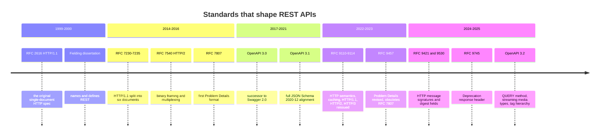

### V.2 Compatibility Matrix

| Standard | Published | Status today | Replaces | What it means for your API |
| --- | --- | --- | --- | --- |
| RFC 9110 HTTP Semantics | June 2022 | Internet Standard | RFC 7231, 7232, 7233, 7235, parts of 7230 | The reference for methods, status codes, conditional requests and content negotiation. Cite it instead of RFC 7231. |
| RFC 9111 HTTP Caching | June 2022 | Internet Standard | RFC 7234 | Defines `Cache-Control`, freshness and validation. |
| RFC 9112 / 9113 / 9114 | June 2022 | Internet Standard / Proposed Standard | RFC 7230, 7540 | HTTP/1.1, HTTP/2 and HTTP/3 wire formats. Semantics are identical across all three. |
| RFC 9457 Problem Details | July 2023 | Proposed Standard | RFC 7807 | Same `application/problem+json` media type; adds a type registry and guidance for multiple problems. |
| RFC 8288 Web Linking | October 2017 | Proposed Standard | RFC 5988 | The `Link` header used for pagination and deprecation links. |
| RFC 7396 JSON Merge Patch | October 2014 | Proposed Standard | RFC 7386 | The `application/merge-patch+json` format the starter's `PATCH` accepts. |
| RFC 6902 JSON Patch | April 2013 | Proposed Standard | none | Operation-list patches (`add`, `remove`, `test`...). |
| RFC 9745 Deprecation header | March 2025 | Proposed Standard | the draft `Deprecation: true` form | Announces that a resource is deprecated, as a structured date. |
| RFC 8594 Sunset header | May 2019 | Informational | none | Announces the date a resource stops working. |
| OpenAPI 3.1 | February 2021 (3.1.1 in October 2024) | Widely supported | OpenAPI 3.0 | Schemas are plain JSON Schema 2020-12. Most tools support it. |
| OpenAPI 3.2 | September 2025 | Current stable; tool support still arriving | OpenAPI 3.1 | Adds `query` operations, `itemSchema` for streams, hierarchical tags. Check your generator before upgrading. |
| Idempotency-Key header | IETF httpapi draft | Draft, widely implemented | none | The header in [M1](#m1-masterclass-idempotency-keys-for-safe-retries). |
| RateLimit header fields | IETF httpapi draft | Draft; field names changed between revisions | ad-hoc `X-RateLimit-*` headers | Pin the draft revision you implement and document it. |

### V.3 What's New in Current Standards

#### Status code names changed in RFC 9110

RFC 9110 moved 422 from the WebDAV spec into core HTTP and renamed two codes. The numbers did not change, so clients keep working; only reason phrases and docs need updating.

```http
HTTP/1.1 422 Unprocessable Entity        (RFC 4918 wording)
HTTP/1.1 413 Payload Too Large           (RFC 7231 wording)
```

```http
HTTP/1.1 422 Unprocessable Content       (RFC 9110 wording)
HTTP/1.1 413 Content Too Large           (RFC 9110 wording)
```

#### Problem Details: RFC 7807 → RFC 9457

The wire format is the same. RFC 9457 clarifies that `type` should be an absolute URI, that `about:blank` means "no extra semantics beyond the status code", and it creates an IANA registry for common problem types. Before and after look identical on the wire; what changes is the citation and the advice on extension members.

```json
{
  "type": "https://api.example.com/problems/validation-error",
  "title": "Your request is not valid",
  "status": 422,
  "detail": "One or more fields failed validation.",
  "instance": "/api/v1/orders",
  "errors": [{ "name": "items", "reason": "must be an array of 1 to 50 line items" }]
}
```

#### The Deprecation header became a structured date

Early drafts used `Deprecation: true`. RFC 9745 defines the value as a Structured Fields date (RFC 9651): `@` followed by a Unix timestamp.

```http
Deprecation: true
Sunset: Wed, 30 Jun 2027 23:59:59 GMT
```

```http
Deprecation: @1782864000
Sunset: Wed, 30 Jun 2027 23:59:59 GMT
Link: <https://api.example.com/docs/migrate-v2>; rel="deprecation"; type="text/html"
```

#### OpenAPI 3.0 → 3.1: schemas are JSON Schema

OpenAPI 3.0 used a modified JSON Schema subset with its own `nullable` keyword. OpenAPI 3.1 adopts JSON Schema 2020-12 as is.

```yaml
# OpenAPI 3.0
openapi: 3.0.3
components:
  schemas:
    Order:
      type: object
      properties:
        note:
          type: string
          nullable: true
        quantity:
          type: integer
          minimum: 1
          exclusiveMaximum: true
          maximum: 1001
```

```yaml
# OpenAPI 3.1
openapi: 3.1.1
components:
  schemas:
    Order:
      type: object
      properties:
        note:
          type: [string, 'null']
        quantity:
          type: integer
          minimum: 1
          exclusiveMaximum: 1001
```

#### OpenAPI 3.2: QUERY operations and streamed items

OpenAPI 3.2 adds a `query` key to path items for the HTTP QUERY method (a safe, idempotent request that carries a body; still an IETF draft at the time of writing), and `itemSchema` to describe each event in a stream such as `text/event-stream` or `application/jsonl`.

```yaml
openapi: 3.2.0
info: { title: Orders, version: 1.0.0 }
paths:
  /orders/search:
    query:
      requestBody:
        content:
          application/json:
            schema: { $ref: '#/components/schemas/OrderSearch' }
      responses:
        '200':
          description: Matching orders
  /orders/events:
    get:
      responses:
        '200':
          description: One JSON object per line
          content:
            application/jsonl:
              itemSchema: { $ref: '#/components/schemas/OrderEvent' }
```

### V.4 Migration Guide (RFC 7231 / RFC 7807 / OpenAPI 3.0 → current)

```bash
# 1. Find stale citations and reason phrases in code and docs.
grep -rnE "RFC ?7231|RFC ?7807|Unprocessable Entity|Payload Too Large" src docs README.md

# 2. Lint the existing OpenAPI document before touching it.
npx @redocly/cli@latest lint openapi.yaml

# 3. Change the version field, then fix what the linter reports:
#    nullable: true          -> type: [X, 'null']
#    exclusiveMaximum: true  -> exclusiveMaximum: <number>
#    example: ...            -> examples: [ ... ]
#    format: binary bodies   -> contentMediaType: application/octet-stream
sed -i 's/^openapi: 3\.0\.[0-9]*/openapi: 3.1.1/' openapi.yaml
npx @redocly/cli@latest lint openapi.yaml

# 4. Lint against your style rules too (naming, error schemas, pagination).
npx @stoplight/spectral-cli lint openapi.yaml

# 5. Regenerate clients and SDKs, then run contract tests against a deployed build.
```

For Problem Details, keep the media type and members; change the reason phrases and documentation links, and make every `type` an absolute URI.

### V.5 Deprecations & Breaking Changes

| Since | Deprecated / removed | Replacement | What breaks and how to fix it |
| --- | --- | --- | --- |
| RFC 9110 (2022) | RFC 2616 and RFC 7230-7235 as references | RFC 9110, 9111, 9112 | Nothing on the wire. Update citations; some reason phrases changed. |
| RFC 9457 (2023) | RFC 7807 | RFC 9457 | Nothing on the wire. Relative `type` URIs are discouraged; make them absolute. |
| RFC 6648 (2012) | The `X-` prefix convention for new headers | Plain registered names (`RateLimit`, `Idempotency-Key`) | Existing `X-` headers keep working; do not mint new ones. |
| OpenAPI 3.1 | `nullable`, boolean `exclusiveMinimum`/`exclusiveMaximum` | `type: [T, 'null']`, numeric exclusives | 3.0-only tools reject 3.1 documents. Upgrade generators first. |
| RFC 9745 (2025) | `Deprecation: true` | `Deprecation: @<unix-time>` | Clients parsing the boolean form need an update. |
| RFC 9700 (2025) | OAuth implicit grant and resource-owner password grant | Authorization code with PKCE; client credentials for services | Browser apps that read tokens from the URL fragment must move to PKCE. |

---

## 📋 Table of Contents

- [🆕 Versions, What's New & Migration](#-rest-api-versions-whats-new--migration)
- [1. Stage 1: REST Foundations, HTTP Messages & the Starter Project](#1-stage-1-rest-foundations-http-messages--the-starter-project)
  - [1.1 What REST Is: Fielding's Constraints](#11-what-rest-is-fieldings-constraints)
  - [1.2 REST vs RPC vs GraphQL vs gRPC](#12-rest-vs-rpc-vs-graphql-vs-grpc)
  - [1.3 The Richardson Maturity Model](#13-the-richardson-maturity-model)
  - [1.4 Anatomy of an HTTP Message](#14-anatomy-of-an-http-message)
  - [1.5 Running the Starter Project](#15-running-the-starter-project)
  - [1.6 Line-by-Line: From Socket to Handler](#16-line-by-line-from-socket-to-handler)
  - [1.7 Calling the API from Any Language](#17-calling-the-api-from-any-language)
  - [1.8 Pitfalls](#18-pitfalls)
  - [1.9 Best Practices](#19-best-practices)
  - [1.10 Hands-on Exercise](#110-hands-on-exercise)
- [2. Stage 2: HTTP Semantics: Methods, Status Codes, Conditional Requests & Caching](#2-stage-2-http-semantics-methods-status-codes-conditional-requests--caching)
  - [2.1 Safe and Idempotent Methods](#21-safe-and-idempotent-methods)
  - [2.2 POST vs PUT vs PATCH](#22-post-vs-put-vs-patch)
  - [2.3 Choosing a Status Code](#23-choosing-a-status-code)
  - [2.4 Media Types and Content Negotiation](#24-media-types-and-content-negotiation)
  - [2.5 Conditional Requests and Entity Tags](#25-conditional-requests-and-entity-tags)
  - [2.6 HTTP Caching with Cache-Control](#26-http-caching-with-cache-control)
  - [2.7 Headers Every REST API Uses](#27-headers-every-rest-api-uses)
  - [2.8 Pitfalls](#28-pitfalls)
  - [2.9 Best Practices](#29-best-practices)
  - [2.10 Hands-on Exercise](#210-hands-on-exercise)
- [3. Stage 3: Resource Modeling, URI Design, Filtering & Pagination](#3-stage-3-resource-modeling-uri-design-filtering--pagination)
  - [3.1 Identifying Resources](#31-identifying-resources)
  - [3.2 URI Design Rules](#32-uri-design-rules)
  - [3.3 Modeling State and Actions](#33-modeling-state-and-actions)
  - [3.4 Designing Representations](#34-designing-representations)
  - [3.5 Filtering, Sorting and Sparse Fieldsets](#35-filtering-sorting-and-sparse-fieldsets)
  - [3.6 Pagination: Offset vs Keyset](#36-pagination-offset-vs-keyset)
  - [3.7 Hypermedia and Link Formats](#37-hypermedia-and-link-formats)
  - [3.8 Bulk and Long-Running Operations](#38-bulk-and-long-running-operations)
  - [3.9 Pitfalls](#39-pitfalls)
  - [3.10 Best Practices](#310-best-practices)
  - [3.11 Hands-on Exercise](#311-hands-on-exercise)
- [4. Stage 4: Errors, Versioning & API Evolution](#4-stage-4-errors-versioning--api-evolution)
  - [4.1 Comparison of Versioning Strategies](#41-comparison-of-versioning-strategies)
  - [4.2 Problem Details for HTTP APIs (RFC 9457)](#42-problem-details-for-http-apis-rfc-9457)
  - [4.3 A Global Problem Details Error Responder (Express)](#43-a-global-problem-details-error-responder-express)
- [5. Stage 5: Security, Rate Limiting & Hardening](#5-stage-5-security-rate-limiting--hardening)
  - [5.1 Sliding-Window Rate Limiter with RateLimit Headers](#51-sliding-window-rate-limiter-with-ratelimit-headers)
  - [5.2 Production CORS Configuration](#52-production-cors-configuration)
- [6. Stage 6: OpenAPI, Contract Testing & Tooling](#6-stage-6-openapi-contract-testing--tooling)
  - [6.1 OpenAPI 3.1 Document Example (openapi.yaml)](#61-openapi-31-document-example-openapiyaml)
  - [6.2 Contract Tests with Supertest and Vitest](#62-contract-tests-with-supertest-and-vitest)
  - [6.3 Reference Express CRUD Router with Zod Validation](#63-reference-express-crud-router-with-zod-validation)
- [M1. Masterclass: Idempotency Keys for Safe Retries](#m1-masterclass-idempotency-keys-for-safe-retries)
  - [M1.1 How the Idempotency-Key Protocol Works](#m11-how-the-idempotency-key-protocol-works)
  - [M1.2 Express Middleware Backed by Redis](#m12-express-middleware-backed-by-redis)
- [M2. Masterclass: Signed Webhook Delivery](#m2-masterclass-signed-webhook-delivery)
  - [M2.1 Webhook Delivery Worker with HMAC-SHA256 Signatures](#m21-webhook-delivery-worker-with-hmac-sha256-signatures)
- [7. Stage 7: Staff REST API Architect Interview Handbook & Cheatsheet](#7-stage-7-staff-rest-api-architect-interview-handbook--cheatsheet)
  - [7.1 Core Concepts (Q1-Q10)](#71-core-concepts-q1-q10)
  - [7.2 Internals & Performance (Q11-Q20)](#72-internals--performance-q11-q20)
  - [7.3 Architecture & Design (Q21-Q30)](#73-architecture--design-q21-q30)
  - [7.4 Scenario & Debugging Questions (Q31-Q50)](#74-scenario--debugging-questions-q31-q50)
  - [7.5 Staff Cheatsheet](#75-staff-cheatsheet)
- [🧪 Example Projects](#-example-projects)
- [📝 Cheat Sheets](#-cheat-sheets)
- [📚 Resources](#-resources)
- [🤝 Contributing](#-contributing)
- [📄 License](#-license)
- [🙏 Acknowledgments](#-acknowledgments)
- [🌐 Connect with me](#-connect-with-me)
- [☕ Support](#-support)

---

## 1. Stage 1: REST Foundations, HTTP Messages & the Starter Project

This stage explains what REST is, how it differs from RPC and GraphQL, and what an HTTP exchange looks like on the wire. You need a terminal, `curl`, and Node.js 22 or later. By the end you can run the starter orders API, read its request path from `server.ts` to the handler, and call it from five languages.

**How this guide shows code.** REST is language-neutral, so most examples are raw HTTP messages, `curl` commands and OpenAPI YAML, which work the same whatever your stack is. The starter server is TypeScript on plain `node:http` with no framework: Node is the runtime most REST tutorials and API gateways target, and without Express or Fastify in the way every status code and header is set explicitly in code you can read. Where the guide compares clients, it gives Go, Java, Python and TypeScript side by side. Express and Zod appear in later stages as the production-framework comparison.

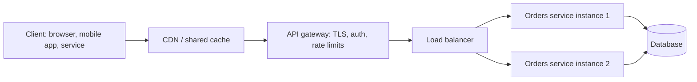

Every box between the client and the service is an intermediary the client cannot see. That is REST's layered-system constraint at work, and it only holds up if each message carries enough information (method, headers, cache directives) for the intermediaries to act correctly.

### 1.1 What REST Is: Fielding's Constraints

Roy Fielding named and defined Representational State Transfer in his 2000 doctoral dissertation. REST is a set of constraints on how components interact; a system that follows them gets particular properties (scalability, independent evolution, visibility to intermediaries). An API is not RESTful because it uses JSON or HTTP; it is RESTful to the degree it follows the constraints.

| Constraint | What it requires | What you get | What breaks when you ignore it |
| --- | --- | --- | --- |
| Client-server | UI concerns live in the client, data and business rules on the server. | Each side evolves and scales on its own. | Shared session code between web app and API couples their releases. |
| Stateless | Each request carries everything needed to process it (credentials, cursor, preferences). The server keeps no conversational state between requests. | Any instance can serve any request; horizontal scaling needs no sticky sessions. | A server-side "current page" variable fails as soon as the next request lands on another instance. |
| Cacheable | Responses say whether and how long they may be reused (`Cache-Control`, `ETag`). | Browsers, CDNs and proxies absorb read traffic. | Unlabelled responses are either never cached (wasted capacity) or cached wrongly (stale data). |
| Uniform interface | Resources are identified by URIs, manipulated through representations, messages are self-descriptive, and hypermedia drives state transitions. | Generic clients and intermediaries understand every API the same way. | Custom verbs inside JSON bodies (`{"action":"delete"}`) hide intent from caches, logs and gateways. |
| Layered system | A component sees only the layer it talks to. | Gateways, CDNs and load balancers slot in without client changes. | Clients that pin to a server IP or rely on connection-level state break behind a proxy. |
| Code on demand (optional) | The server may send executable code (scripts) to extend the client. | Thin clients can gain features at runtime. | Rarely used by JSON APIs; skipping it does not make an API less RESTful. |

The uniform interface has four sub-constraints, and they are the ones API designers argue about most:

1. **Identification of resources.** Each thing the client can talk about has a URI: `/api/v1/orders/ord_7f3a...`.
2. **Manipulation through representations.** The client holds a representation (a JSON document) and sends a representation back to change state. It never touches the server's storage format.
3. **Self-descriptive messages.** Method, status code and headers (`Content-Type`, `Cache-Control`) say how to interpret a message without out-of-band knowledge.
4. **Hypermedia as the engine of application state (HATEOAS).** Responses contain links to the next valid actions, so clients follow links instead of building URLs.

### 1.2 REST vs RPC vs GraphQL vs gRPC

Choosing REST is a trade-off, not a default. The diagram contrasts how each style frames an interaction.

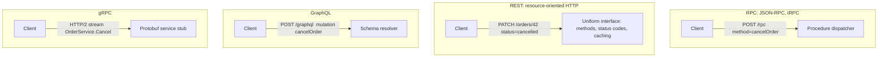

| Concern | REST | RPC over HTTP | GraphQL | gRPC |
| --- | --- | --- | --- | --- |
| Unit of design | Resources and their representations | Procedures | A typed graph and client-chosen queries | Services and Protobuf messages |
| HTTP caching | Native: `GET` + `Cache-Control` + `ETag` work in every CDN | Usually none (everything is `POST`) | Hard: one `POST /graphql` endpoint; needs persisted queries for `GET` caching | None at the HTTP layer |
| Over/under-fetching | Fixed shapes; mitigated with sparse fieldsets and expansion | Fixed per procedure | Client asks for exactly the fields it needs | Fixed per message |
| Error model | Status codes + Problem Details | Usually 200 with an error object | Usually 200 with an `errors` array | `google.rpc.Status` codes |
| Contract | OpenAPI (optional, but common) | Ad hoc or shared types (tRPC) | Mandatory schema (SDL) | Mandatory `.proto` |
| Browser support | Full | Full | Full | Needs gRPC-Web or a proxy |
| Best fit | Public APIs, CRUD-heavy domains, anything behind CDNs | Internal calls in one codebase | Many client types with different data needs | Low-latency service-to-service traffic, streaming |

A common production layout mixes them: REST at the public edge, gRPC between internal services, and GraphQL as a backend-for-frontend aggregating both.

### 1.3 The Richardson Maturity Model

Leonard Richardson's model grades how much of HTTP an API uses. It is a teaching tool, not a certification, but it gives teams a shared vocabulary.

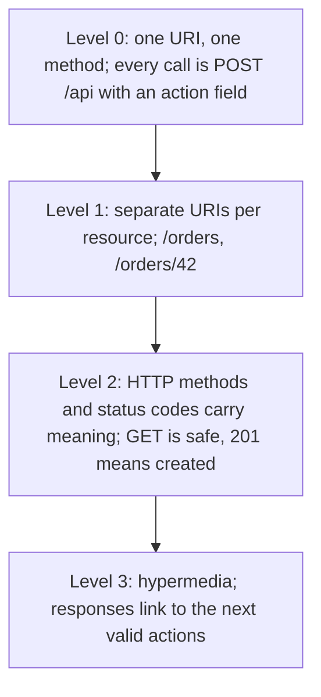

The same "cancel order 42" operation at each level:

```http
POST /api HTTP/1.1
Content-Type: application/json

{"action": "cancelOrder", "orderId": 42}
```

Level 0. One endpoint; the method and URI tell intermediaries nothing.

```http
POST /orders/42/cancel HTTP/1.1
```

Level 1. The resource has its own URI, but the verb lives in the path and every call is still `POST`.

```http
PATCH /orders/42 HTTP/1.1
Content-Type: application/merge-patch+json
If-Match: "c2b1e0"

{"status": "cancelled"}
```

Level 2. The method says "partial update", the precondition protects against lost updates, and the response code (200, 409, 412) carries the outcome.

```http
HTTP/1.1 200 OK
Content-Type: application/json

{
  "id": "42",
  "status": "pending",
  "_links": {
    "self":   { "href": "/orders/42" },
    "pay":    { "href": "/orders/42/payments" },
    "cancel": { "href": "/orders/42" }
  }
}
```

Level 3. The representation advertises what the client may do next. When the order ships, the server stops sending the `cancel` link and the UI hides the button without a client release. The starter reaches Level 2 everywhere and uses links for discovery (`GET /`), item navigation and pagination.

### 1.4 Anatomy of an HTTP Message

Every REST interaction is one request and one response. HTTP/1.1, HTTP/2 and HTTP/3 frame them differently on the wire, but the semantics (method, target, fields, content) are identical, which is why RFC 9110 defines them once for all three.

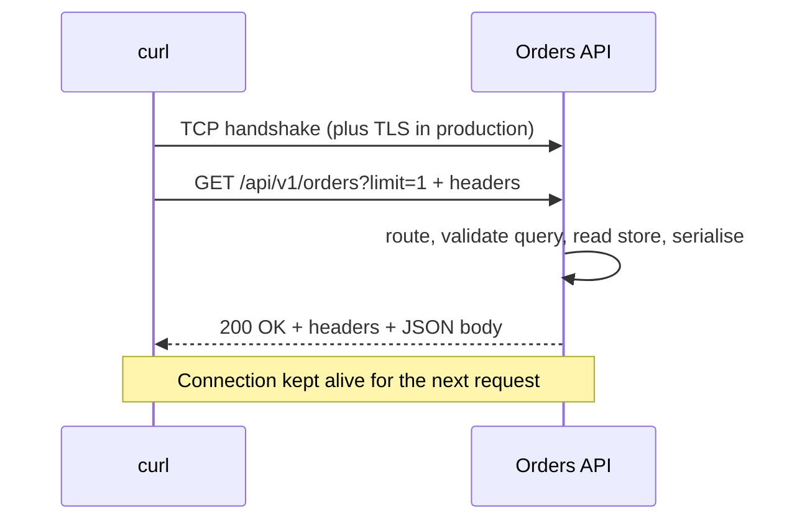

Run the starter (section 1.5) and look at a real exchange. `-v` prints the request lines prefixed with `>` and the response with `<`:

```bash
curl -v "http://localhost:8080/api/v1/orders?limit=1"
```

```http
> GET /api/v1/orders?limit=1 HTTP/1.1
> Host: localhost:8080
> User-Agent: curl/8.10.1
> Accept: */*
>
< HTTP/1.1 200 OK
< X-Request-Id: 71485fe4-aef3-4366-a799-1c60cdbdfbc4
< Content-Type: application/json
< Content-Length: 634
< Cache-Control: private, no-cache
< Link: </api/v1/orders?limit=1&cursor=WyIyMDI2LTExLTAz...>; rel="next"
< Date: Tue, 03 Nov 2026 04:27:06 GMT
< Connection: keep-alive
< Keep-Alive: timeout=5
<
{"data":[{"id":"ord_c3c18b4961c34202a2a7","customer":"alice", ...}], "page": {...}, "_links": {...}}
```

| Part | Example | Role |
| --- | --- | --- |
| Method | `GET` | What the client wants done. Defines safety and idempotency (Stage 2). |
| Request target | `/api/v1/orders?limit=1` | Path identifies the resource; query refines it (filters, page size). |
| `Host` | `localhost:8080` | Required in HTTP/1.1. Lets one IP serve many sites. Never trust it for building absolute URLs. |
| `Accept` | `*/*` | Media types the client can handle; drives content negotiation. |
| Status line | `200 OK` | The outcome class (2xx success) and the specific result. |
| `Content-Type` | `application/json` | How to parse the body. JSON has no `charset` parameter; it is always UTF-8. |
| `Content-Length` | `634` | Body size in bytes, so the client knows where the message ends on a kept-alive connection. |
| `Cache-Control` | `private, no-cache` | Browser may store it, shared caches may not, and it must be revalidated before reuse. |
| `Link` | `rel="next"` | RFC 8288 web link to the next page, usable without parsing the body. |
| `X-Request-Id` | UUID | Correlates this response with server logs. |

### 1.5 Running the Starter Project

The starter is an orders service that implements every rule from Stages 1-3: method semantics, status codes, Problem Details errors, ETags, merge-patch updates, filtering, sparse fieldsets, keyset pagination and idempotency keys. It has no runtime dependencies; TypeScript and `@types/node` are the only dev dependencies.

```text
learn-rest-api/
├── src/
│   ├── server.ts            process entry: PORT, 0.0.0.0, graceful shutdown
│   ├── app.ts               routes /, /health, error boundary, request IDs
│   ├── http/
│   │   ├── router.ts        path params, 404 vs 405 + Allow, HEAD and OPTIONS
│   │   ├── body.ts          JSON body reader: 415, 413, 400
│   │   ├── problem.ts       RFC 9457 Problem Details
│   │   ├── etag.ts          strong ETags, If-None-Match, If-Match
│   │   ├── pagination.ts    keyset cursors over (createdAt, id)
│   │   ├── idempotency.ts   Idempotency-Key replay store
│   │   └── respond.ts       JSON and empty responses
│   └── orders/
│       ├── model.ts         types, validation, merge patch, status machine
│       ├── store.ts         in-memory store with seed data
│       └── routes.ts        the /api/v1/orders endpoints
├── test/
│   ├── api.test.ts          HTTP-level tests against a real server
│   ├── units.test.ts        router, ETag, cursor, model unit tests
│   └── helpers.ts
├── Dockerfile               multi-stage, non-root, port 8080
└── .github/workflows/ci.yml install, type-check, test, build, Docker smoke test
```

```bash
git clone https://github.com/TheLearningHubOrg/learn-rest-api.git
cd learn-rest-api
npm ci            # installs the exact versions in package-lock.json
npm test          # compiles to dist/ and runs node:test (36 tests)
npm start         # node dist/src/server.js on http://0.0.0.0:8080

# or in a container
docker build -t learn-rest-api .
docker run --rm -p 8080:8080 learn-rest-api
curl -s localhost:8080/health      # {"status":"ok"}
```

| Endpoint | Methods | Purpose |
| --- | --- | --- |
| `/` | `GET`, `HEAD` | Entry point with links to every resource |
| `/health` | `GET`, `HEAD` | Liveness probe used by Docker, CI and orchestrators |
| `/api/v1/orders` | `GET`, `HEAD`, `POST`, `OPTIONS` | List (filter, sort, paginate, project) and create |
| `/api/v1/orders/{id}` | `GET`, `HEAD`, `PUT`, `PATCH`, `DELETE`, `OPTIONS` | Read, replace, merge-patch and delete one order |

### 1.6 Line-by-Line: From Socket to Handler

The process entry point is short on purpose. Its only jobs are configuration and lifecycle.

```ts
// src/server.ts
import { createServer } from 'node:http';
import { createApp } from './app.js';
import { OrderStore, seedStore } from './orders/store.js';

const port = Number(process.env.PORT ?? 8080);
// 0.0.0.0, not localhost: inside a container, localhost is unreachable from outside.
const host = process.env.HOST ?? '0.0.0.0';

const server = createServer(createApp({ store: seedStore(new OrderStore()) }));

server.listen(port, host, () => {
  console.log(`orders API listening on http://${host}:${port}`);
});

// Docker and Kubernetes send SIGTERM; finish in-flight requests, then exit.
for (const signal of ['SIGTERM', 'SIGINT'] as const) {
  process.on(signal, () => {
    server.close(() => process.exit(0));
    server.closeIdleConnections();
  });
}
```

| Line / API | Role | What happens at runtime |
| --- | --- | --- |
| `process.env.PORT ?? 8080` | Twelve-factor configuration | The same image runs on any port the platform assigns. |
| `host = '0.0.0.0'` | Bind address | Accepts connections on every interface. Binding `127.0.0.1` inside a container makes the published port unreachable. |
| `createApp({ store })` | Dependency injection by argument | Tests pass their own store; production passes seeded data. No globals. |
| `server.close(cb)` | Graceful shutdown | Stops accepting new connections and calls `cb` once in-flight requests finish. |
| `closeIdleConnections()` | Keep-alive cleanup | Idle kept-alive sockets would otherwise hold `close()` open until they time out. |

`createApp` returns a plain `RequestListener`, so the same function works with `http.createServer`, `https.createServer` or a test harness. Its `handle` function is the request pipeline:

```ts
// src/app.ts (excerpt)
async function handle(router: Router, req: IncomingMessage, res: ServerResponse): Promise<void> {
  // Never build URLs from the Host header; it is client-controlled.
  const url = new URL(req.url ?? '/', 'http://localhost');
  const method = (req.method ?? 'GET').toUpperCase();

  const incomingId = req.headers['x-request-id'];
  const requestId = typeof incomingId === 'string' && REQUEST_ID.test(incomingId) ? incomingId : randomUUID();
  res.setHeader('X-Request-Id', requestId);

  try {
    const match = router.match(method, url.pathname);
    switch (match.kind) {
      case 'found':
        await match.handler({ req, res, url, params: match.params });
        return;
      case 'options':
        sendEmpty(res, 204, { Allow: match.allow.join(', ') });
        return;
      case 'method-not-allowed':
        throw new HttpError(405, 'method-not-allowed', 'Method Not Allowed', `${method} is not supported on ${url.pathname}.`, {
          headers: { Allow: match.allow.join(', ') },
        });
      case 'not-found':
        throw new HttpError(404, 'not-found', 'Not Found', `Nothing lives at ${url.pathname}.`);
    }
  } catch (err) {
    if (res.headersSent) {
      res.destroy(err as Error);
      return;
    }
    if (err instanceof HttpError) {
      sendProblem(res, err.toProblem(url.pathname), err.headers);
      return;
    }
    console.error(`[${requestId}] ${method} ${url.pathname} failed`, err);
    sendProblem(res, {
      type: 'about:blank',
      title: 'Internal Server Error',
      status: 500,
      detail: `Something went wrong on our side. Quote request id ${requestId} if you contact support.`,
      instance: url.pathname,
    });
  }
}
```

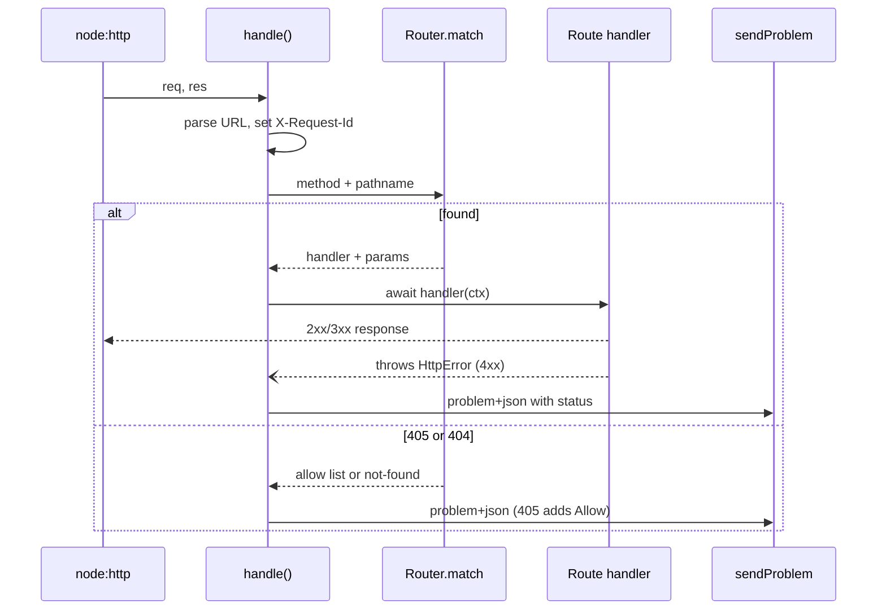

| Line / API | Role | What happens at runtime |
| --- | --- | --- |
| `new URL(req.url, 'http://localhost')` | Parse path and query | The fixed base avoids trusting `Host`; only `pathname` and `searchParams` are used. |
| `REQUEST_ID.test(incomingId)` | Input hygiene | Accepts a caller's ID for tracing but rejects values that could inject into logs. |
| `match.kind` | Discriminated union | TypeScript forces every routing outcome to be handled: found, OPTIONS, 405, 404. |
| `throw new HttpError(...)` | Single error path | Handlers never format errors; they throw, and the boundary renders Problem Details. |
| `res.headersSent` | Late failure | If the status line is already on the wire, the only honest option is to abort the connection. |
| `type: 'about:blank'` | Opaque 500 | The client learns only the status and a request ID; the stack trace goes to logs. |

### 1.7 Calling the API from Any Language

A REST API is consumed by whatever language the client team uses, so it must not depend on any one SDK. These clients all fetch the first page of orders with a timeout, check the status, and decode JSON.

```bash
# curl: -f fails on 4xx/5xx, -sS hides progress but keeps errors
curl -fsS -H 'Accept: application/json' --max-time 5 "http://localhost:8080/api/v1/orders?limit=2"
```

```ts
// list-orders.ts  (Node 22.18+ or 24 run TypeScript directly: node list-orders.ts)
interface OrderPage {
  data: { id: string; status: string; totalCents: number }[];
  page: { limit: number; nextCursor: string | null };
}

const res = await fetch('http://localhost:8080/api/v1/orders?limit=2', {
  headers: { Accept: 'application/json' },
  signal: AbortSignal.timeout(5000),
});
if (!res.ok) throw new Error(`HTTP ${res.status}: ${await res.text()}`);
const page = (await res.json()) as OrderPage;
for (const order of page.data) console.log(order.id, order.status, order.totalCents);
console.log('next page:', res.headers.get('link'));
```

```go
// main.go  (go run main.go)
package main

import (
	"encoding/json"
	"fmt"
	"log"
	"net/http"
	"time"
)

type orderPage struct {
	Data []struct {
		ID         string `json:"id"`
		Status     string `json:"status"`
		TotalCents int    `json:"totalCents"`
	} `json:"data"`
	Page struct {
		NextCursor *string `json:"nextCursor"`
	} `json:"page"`
}

func main() {
	client := &http.Client{Timeout: 5 * time.Second}
	req, err := http.NewRequest(http.MethodGet, "http://localhost:8080/api/v1/orders?limit=2", nil)
	if err != nil {
		log.Fatal(err)
	}
	req.Header.Set("Accept", "application/json")

	res, err := client.Do(req)
	if err != nil {
		log.Fatal(err)
	}
	defer res.Body.Close()
	if res.StatusCode != http.StatusOK {
		log.Fatalf("unexpected status %s", res.Status)
	}

	var page orderPage
	if err := json.NewDecoder(res.Body).Decode(&page); err != nil {
		log.Fatal(err)
	}
	for _, o := range page.Data {
		fmt.Println(o.ID, o.Status, o.TotalCents)
	}
	fmt.Println("next page:", res.Header.Get("Link"))
}
```

```java
// ListOrders.java  (java ListOrders.java, JDK 11+ runs single source files directly)
import java.net.URI;
import java.net.http.HttpClient;
import java.net.http.HttpRequest;
import java.net.http.HttpResponse;
import java.time.Duration;

public class ListOrders {
    public static void main(String[] args) throws Exception {
        HttpClient client = HttpClient.newBuilder()
                .connectTimeout(Duration.ofSeconds(5))
                .build();
        HttpRequest request = HttpRequest.newBuilder(URI.create("http://localhost:8080/api/v1/orders?limit=2"))
                .header("Accept", "application/json")
                .timeout(Duration.ofSeconds(5))
                .GET()
                .build();
        HttpResponse<String> response = client.send(request, HttpResponse.BodyHandlers.ofString());
        if (response.statusCode() != 200) {
            throw new IllegalStateException("HTTP " + response.statusCode() + ": " + response.body());
        }
        System.out.println(response.body());
        response.headers().firstValue("link").ifPresent(link -> System.out.println("next page: " + link));
    }
}
```

```python
# list_orders.py  (pip install httpx; python list_orders.py)
import httpx

response = httpx.get(
    "http://localhost:8080/api/v1/orders",
    params={"limit": 2},
    headers={"Accept": "application/json"},
    timeout=5.0,
)
response.raise_for_status()
for order in response.json()["data"]:
    print(order["id"], order["status"], order["totalCents"])
print("next page:", response.headers.get("link"))
```

| Client | Default timeout | Non-2xx raises? | Notes |
| --- | --- | --- | --- |
| `curl` | none | only with `-f` | Add `--max-time` in scripts. |
| `fetch` (Node, browsers) | none | no, check `res.ok` | Use `AbortSignal.timeout()`. |
| Go `net/http` | none on `http.DefaultClient` | no | Always build your own `http.Client` with `Timeout`; always close `Body`. |
| Java `HttpClient` | none | no | Set both `connectTimeout` and per-request `timeout`. |
| Python `httpx` | 5 seconds | only with `raise_for_status()` | `requests` has no default timeout at all. |

### 1.8 Pitfalls

| Pitfall | Symptom | Fix |
| --- | --- | --- |
| Server binds `localhost` inside a container | `curl: (52) Empty reply from server` or `connection reset` from the host, while it works from inside the container | Bind `0.0.0.0`; the starter reads `HOST` and defaults to it. |
| Verbs in URIs (`POST /getOrders`) | Caches and gateways treat reads as writes; nothing is cached; retries are unsafe | Use `GET /orders`; let the method carry the intent. |
| Returning `200` with `{"error": ...}` | Monitoring shows 0% errors while users see failures; clients must parse every body | Use the right 4xx/5xx status and a Problem Details body. |
| Server-side session state between calls | Pagination or wizards break when the load balancer picks another instance | Put the state in the request: cursors, tokens, explicit IDs. |
| No client timeout | Threads or goroutines pile up during an upstream brownout; process runs out of memory | Set connect and total timeouts on every client (table in 1.7). |
| Building absolute URLs from `Host` | Host header injection: password-reset links point at an attacker's domain | Use relative links or a configured public base URL. |
| Calling an API "RESTful" because it returns JSON | Long debates and inconsistent endpoints | Check the constraints in 1.1 and the maturity level in 1.3. |

### 1.9 Best Practices

- **Model resources, not procedures**: the uniform interface only helps if the resource is the thing being named.
- **Keep the server stateless per request**: it is the property that makes horizontal scaling and failover free.
- **Label every response's cacheability**: an explicit `Cache-Control` beats each intermediary guessing.
- **Use standard media types and headers before inventing new ones**: generic tools already understand them.
- **Generate a request ID at the edge and return it**: support tickets and log searches start from that ID.
- **Keep the entry point thin**: configuration and lifecycle in `server.ts`, behaviour in `createApp`, so tests run the real app without a real port conflict.
- **Fail closed on unknown errors**: a generic 500 with an ID leaks nothing; details go to logs.

### 1.10 Hands-on Exercise

Start the server and, using only `curl` and the links the API returns, go from `/` to the second page of orders and then to one order's `self` link, without typing any `/api/v1/...` path yourself.

```bash
curl -s localhost:8080/ | jq -r '._links.orders.href'
# /api/v1/orders
curl -s "localhost:8080/api/v1/orders?limit=2" | jq -r '._links.next.href'
# /api/v1/orders?limit=2&cursor=WyIy...
curl -s "localhost:8080/api/v1/orders?limit=2&cursor=WyIy..." | jq -r '.data[0]._links.self.href'
# /api/v1/orders/ord_...
curl -si "localhost:8080/api/v1/orders/ord_..." | head -6
```

Expected: the final response is `200 OK` with `ETag` and `Cache-Control: private, no-cache` headers. Then run the same walk from the Go or Java client in 1.7. The link-following logic is tested in `test/api.test.ts` (`walks all pages without duplicates and follows the Link header`) and the entry point lives in `src/app.ts`.

[Back to top ⤴️](#-table-of-contents)

---

## 2. Stage 2: HTTP Semantics: Methods, Status Codes, Conditional Requests & Caching

HTTP already defines what most API operations mean. This stage covers the parts of RFC 9110 and RFC 9111 that API designers use daily: method properties, status codes, media types, entity tags and cache directives. Prerequisite: Stage 1 and a running starter. Afterwards you can choose the right method and status for any operation and add safe concurrency control and caching to an endpoint.

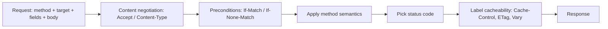

### 2.1 Safe and Idempotent Methods

Two properties decide how clients, caches and proxies may treat a request:

- **Safe**: the client does not ask for any state change. Crawlers, prefetchers and caches may send safe requests freely. The server can still log or count them; what matters is that the client is not responsible for side effects.
- **Idempotent**: sending the request N times has the same intended effect on the server as sending it once. Clients and proxies may retry an idempotent request after a network failure without asking the user.

Every safe method is idempotent. The reverse is not true.

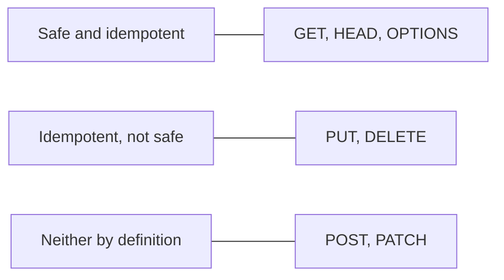

| Method | Safe | Idempotent | Request body | Typical success codes | Purpose |
| :--- | :--- | :--- | :--- | :--- | :--- |
| `GET` | Yes | Yes | No defined meaning; avoid | `200`, `206`, `304` | Retrieve a representation. |
| `HEAD` | Yes | Yes | No | `200`, `304` | Same headers as `GET`, no body: check existence, size or `ETag`. |
| `OPTIONS` | Yes | Yes | Rare | `204`, `200` | Describe allowed methods (`Allow`); used by CORS preflight. |
| `POST` | No | No | Yes | `201`, `200`, `202`, `204` | Process the body according to the resource's own rules; usually "create a subordinate". |
| `PUT` | No | Yes | Yes | `200`, `204`, `201` | Replace the target's state with the enclosed representation (or create it at that URI). |
| `PATCH` | No | No (format-dependent) | Yes | `200`, `204` | Apply a set of changes described by a patch document (RFC 5789). |
| `DELETE` | No | Yes | No defined meaning; avoid | `204`, `200`, `202` | Remove the association between the URI and its resource. |

Two details trip people up. First, idempotency is about **state**, not responses: the first `DELETE /orders/42` returns `204`, the second returns `404`, and both leave the same state (no order 42). Second, "same intended effect" includes metadata. The starter's store skips a write when a `PUT` repeats the current state, so `updatedAt` and the `ETag` stay the same and a retried `PUT` is indistinguishable from the original:

```ts
// src/orders/store.ts
replace(id: string, input: OrderInput): Order | undefined {
  const current = this.orders.get(id);
  if (!current) return undefined;
  // Re-sending the same state changes nothing, not even updatedAt, so a
  // retried PUT returns the same ETag as the first one.
  if (JSON.stringify(toInput(current)) === JSON.stringify(input)) return current;
  const next: Order = {
    id,
    ...input,
    totalCents: totalOf(input.items),
    createdAt: current.createdAt,
    updatedAt: this.now().toISOString(),
    version: current.version + 1,
  };
  this.orders.set(id, next);
  return next;
}
```

```bash
# Repeat this twice: same status, same ETag both times.
curl -si -X PUT localhost:8080/api/v1/orders/ord_... \
  -H 'Content-Type: application/json' \
  -d '{"customer":"alice","status":"paid","items":[{"sku":"BOOK-001","quantity":2,"unitPriceCents":1500}]}' \
  | grep -i etag
```

### 2.2 POST vs PUT vs PATCH

The three write methods differ in who chooses the URI and how much of the resource the body describes.

| Question | `POST /orders` | `PUT /orders/{id}` | `PATCH /orders/{id}` |
| --- | --- | --- | --- |
| Who picks the ID? | Server | Client (the URI is the ID) | Resource must exist |
| Body describes | Input to a process | The complete new state | Only the changes |
| Omitted fields | Server defaults | Cleared or defaulted | Left untouched |
| Retry safe? | No, unless you add an `Idempotency-Key` ([M1](#m1-masterclass-idempotency-keys-for-safe-retries)) | Yes | Depends on the patch format |
| Starter behaviour | `201` + `Location` + `ETag` | `200`, full replace of `customer`, `items`, `status`, `note` | `200`, JSON Merge Patch |

The starter assigns IDs on the server, so `PUT` to an unknown ID returns `404` instead of creating. That is a design choice: allowing "PUT to create" suits resources whose natural key the client owns (`PUT /users/{username}/avatar`), and it must then return `201` on creation and `200`/`204` on replacement.

**Patch formats.** `PATCH` has no single format; the `Content-Type` names one.

| Format | Media type | Example body | Idempotent | Can express |
| --- | --- | --- | --- | --- |
| JSON Merge Patch (RFC 7396) | `application/merge-patch+json` | `{"note": null, "status": "paid"}` | Yes | Set and delete object members. Cannot set a value to `null`, cannot edit one array element. |
| JSON Patch (RFC 6902) | `application/json-patch+json` | `[{"op":"test","path":"/status","value":"pending"},{"op":"add","path":"/items/-","value":{...}}]` | No (`add` to `/-` appends each time) | Array edits, moves, and atomic `test` guards. |

The starter's merge-patch implementation is ten lines:

```ts
// src/orders/model.ts
export function mergePatch(target: unknown, patch: unknown): unknown {
  if (!isRecord(patch)) return patch;
  const result: Record<string, unknown> = isRecord(target) ? { ...target } : {};
  for (const [key, value] of Object.entries(patch)) {
    if (value === null) delete result[key];
    else result[key] = mergePatch(result[key], value);
  }
  return result;
}
```

| Line | Rule from RFC 7396 |
| --- | --- |
| `if (!isRecord(patch)) return patch` | A non-object patch (string, number, array) replaces the target wholesale. Arrays are never merged. |
| `{ ...target }` | Copy, never mutate the stored order; validation may still reject the result. |
| `value === null` → `delete` | `null` means "remove this member". |
| recursive call | Nested objects merge member by member. |

The `PATCH` handler then validates the **merged result** with the same function `PUT` uses, so a patch can never produce an order a full replacement would reject:

```ts
// src/orders/routes.ts
router.on('PATCH', `${ORDERS}/:id`, async (ctx) => {
  const order = findOrThrow(store, ctx.params.id!);
  checkIfMatch(ctx, order);
  const body = await readJson(ctx.req, { accept: ['application/merge-patch+json'], isPatch: true });
  const input = validated(mergePatch(toInput(order), body.value), false);
  checkTransition(order.status, input.status);
  sendOrder(ctx, 200, store.replace(order.id, input)!);
});
```

```bash
curl -s -X PATCH localhost:8080/api/v1/orders/ord_... \
  -H 'Content-Type: application/merge-patch+json' \
  -d '{"note":"leave at the door"}' | jq '{status, note}'
```

### 2.3 Choosing a Status Code

Clients branch on the status code before they read a byte of the body, so the code must be right. The decision tree below is the order the starter checks things in.

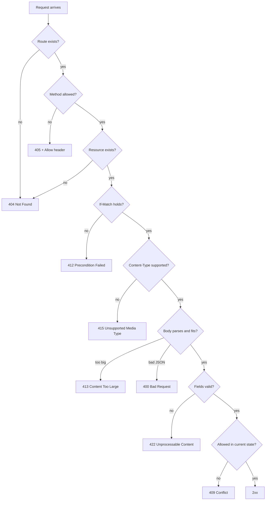

| Code | Meaning | Starter example |
| --- | --- | --- |
| `200 OK` | Success with a representation | `GET`, `PUT`, `PATCH` |
| `201 Created` | A new resource exists at `Location` | `POST /api/v1/orders` |
| `202 Accepted` | Queued for later processing; not done yet | Job resources (Stage 3.8) |
| `204 No Content` | Success, intentionally no body | `DELETE`, `OPTIONS` |
| `304 Not Modified` | Your cached copy is current | `GET` with matching `If-None-Match` |
| `400 Bad Request` | The message itself is malformed | Broken JSON, `?limit=0`, unknown `?sort=` |
| `401 Unauthorized` | Missing or invalid credentials; send `WWW-Authenticate` | Stage 5 |
| `403 Forbidden` | Authenticated but not allowed | Stage 5 |
| `404 Not Found` | No resource at this URI (or you may not know it exists) | Unknown order ID |
| `405 Method Not Allowed` | Resource exists, method does not; must send `Allow` | `DELETE /api/v1/orders` |
| `406 Not Acceptable` | Cannot produce any type in `Accept` | Strict negotiation (2.4) |
| `409 Conflict` | Request conflicts with current state | `cancelled` → `paid` |
| `412 Precondition Failed` | `If-Match` / `If-Unmodified-Since` did not hold | Stale `ETag` on `PATCH` |
| `413 Content Too Large` | Body exceeds the limit | Body over 64 KiB |
| `415 Unsupported Media Type` | Body format not accepted; for `PATCH`, send `Accept-Patch` | `PATCH` with `application/json` |
| `422 Unprocessable Content` | Syntax fine, semantics wrong | Empty `items`, read-only `id` in body |
| `428 Precondition Required` | Server demands a conditional request | Optional hardening for writes |
| `429 Too Many Requests` | Rate limited; send `Retry-After` | Stage 5 |
| `500 Internal Server Error` | Unhandled server fault | Error boundary in `app.ts` |
| `503 Service Unavailable` | Temporarily overloaded or in maintenance; `Retry-After` optional | Load shedding |

**404 vs 405** is the most common mistake in hand-written routers. The starter's router finds the route by path first and only then checks the method, so it can say "this exists, but not for that method":

```bash
curl -si -X DELETE localhost:8080/api/v1/orders | head -5
```

```http
HTTP/1.1 405 Method Not Allowed
Allow: GET, POST, HEAD, OPTIONS
Content-Type: application/problem+json
Cache-Control: no-store
```

**400 vs 422 vs 409**: 400 means the server could not understand the message (bad JSON, bad query syntax). 422 means it understood it, but the content breaks validation rules. 409 means the content is valid in general but not for the resource's current state. A client can fix a 422 by changing its input; it fixes a 409 by re-reading the resource first.

### 2.4 Media Types and Content Negotiation

`Content-Type` describes the body being sent; `Accept` lists what the client can receive. The server must reject request bodies it cannot parse (415) and may refuse to answer when it cannot produce anything acceptable (406).

```ts
// src/http/body.ts (excerpt)
export function mediaType(header: string | undefined): string {
  return (header ?? '').split(';')[0]!.trim().toLowerCase();
}

export async function readJson(req: IncomingMessage, options: ReadOptions): Promise<ParsedBody> {
  const maxBytes = options.maxBytes ?? 64 * 1024;
  const type = mediaType(req.headers['content-type']);

  if (!options.accept.includes(type)) {
    throw new HttpError(415, 'unsupported-media-type', 'Unsupported Media Type',
      `Send the body as ${options.accept.join(' or ')}; received "${type || 'no Content-Type'}".`,
      options.isPatch ? { headers: { 'Accept-Patch': options.accept.join(', ') } } : {});
  }

  const declared = Number(req.headers['content-length'] ?? 0);
  if (declared > maxBytes) throw tooLarge(maxBytes);

  const chunks: Buffer[] = [];
  let size = 0;
  for await (const chunk of req) {
    const buf = chunk as Buffer;
    size += buf.length;
    if (size > maxBytes) throw tooLarge(maxBytes);
    chunks.push(buf);
  }
  // ... JSON.parse, 400 on failure
}
```

| Line / API | Role | What happens at runtime |
| --- | --- | --- |
| `split(';')[0]` | Strip parameters | `application/json; charset=utf-8` matches `application/json`. |
| `toLowerCase()` | Case-insensitive type | Media types are case-insensitive; `Application/JSON` is legal. |
| `Accept-Patch` | Discoverability | Tells a client which patch formats would have worked. |
| `declared > maxBytes` | Early rejection | Refuses an oversized upload before reading it. |
| `size > maxBytes` in the loop | Defence against lying clients | Chunked bodies have no `Content-Length`; the running total still enforces the limit. |

Negotiation on the response side uses quality values. A request with `Accept: text/csv;q=0.9, application/json` prefers JSON (implicit `q=1`) and accepts CSV. When one URI can return several formats, the response must carry `Vary: Accept` so a cache does not hand the CSV copy to a JSON client.

```http
GET /api/v1/orders HTTP/1.1
Accept: text/csv;q=0.9, application/json
Accept-Language: de, en;q=0.5
Accept-Encoding: br, gzip
```

```http
HTTP/1.1 200 OK
Content-Type: application/json
Content-Language: en
Content-Encoding: br
Vary: Accept, Accept-Language, Accept-Encoding
```

| Header | Negotiates | Response counterpart | `Vary` needed |
| --- | --- | --- | --- |
| `Accept` | Media type | `Content-Type` | Yes, if more than one type is served |
| `Accept-Language` | Natural language | `Content-Language` | Yes, if translated |
| `Accept-Encoding` | Compression | `Content-Encoding` | Yes (most servers add it automatically) |

### 2.5 Conditional Requests and Entity Tags

An entity tag (`ETag`) is an opaque validator for one representation. It enables two features with one mechanism:

- **Revalidation**: `GET` with `If-None-Match: <tag>` → `304 Not Modified` with no body when nothing changed.
- **Optimistic concurrency**: `PUT`/`PATCH`/`DELETE` with `If-Match: <tag>` → `412 Precondition Failed` when someone else changed the resource first. This prevents the lost-update problem without locks.

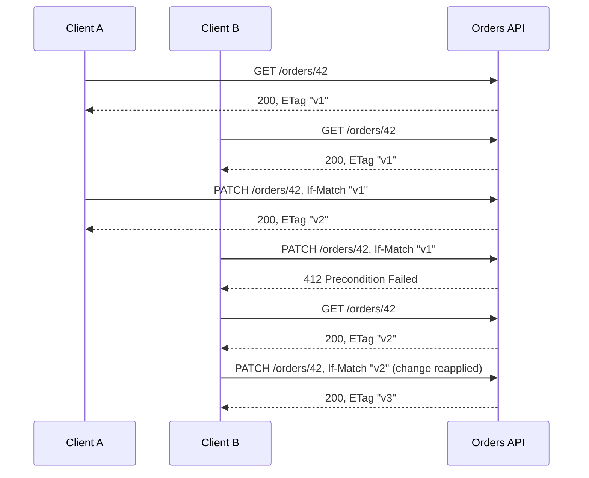

**Strong vs weak.** A strong tag (`"abc"`) promises byte-identical bodies. A weak tag (`W/"abc"`) promises only semantic equivalence, for example the same data with different whitespace or compression. RFC 9110 uses the weak comparison for `If-None-Match` (either kind matches) and the strong comparison for `If-Match` (weak tags never match), because a write must know it is based on exactly what the client saw.

```ts
// src/http/etag.ts
export function etagFor(body: string): string {
  return `"${createHash('sha256').update(body).digest('base64url').slice(0, 27)}"`;
}

const opaque = (tag: string): string => (tag.startsWith('W/') ? tag.slice(2) : tag);

export function ifNoneMatchHits(header: string | undefined, current: string): boolean {
  if (!header) return false;
  if (header.trim() === '*') return true;
  return parseList(header).some((tag) => opaque(tag) === opaque(current));
}

export function ifMatchHolds(header: string | undefined, current: string | undefined): boolean {
  if (header === undefined) return true; // no precondition sent
  if (current === undefined) return false; // resource does not exist
  if (header.trim() === '*') return true;
  return parseList(header).some((tag) => !tag.startsWith('W/') && tag === current);
}
```

| Line / API | Role | What happens at runtime |
| --- | --- | --- |
| `createHash('sha256')...slice(0, 27)` | Content hash | 162 bits of SHA-256 in base64url: collisions are not a practical concern. |
| `opaque(tag)` | Weak comparison | Strips `W/` so `W/"x"` matches `"x"` for revalidation. |
| `'*'` | Wildcard | `If-None-Match: *` means "only if it does not exist" (safe create); `If-Match: *` means "only if it exists". |
| `parseList` | Lists | Clients may send several tags: `If-None-Match: "a", "b"`. |
| `!tag.startsWith('W/')` | Strong comparison | A weak tag can never authorise a write. |

The `GET` handler hashes the exact bytes it is about to send, so a sparse-fieldset response (`?fields=status`) gets its own tag, as it should: it is a different representation.

```ts
// src/orders/routes.ts
router.on('GET', `${ORDERS}/:id`, ({ req, res, url, params }) => {
  const errors: InvalidParam[] = [];
  const fields = parseFields(url, errors);
  if (errors.length > 0) throw invalidQuery(errors);

  const order = findOrThrow(store, params.id!);
  const text = JSON.stringify(project(represent(order), fields));
  const tag = etagFor(text);
  const headers = { ETag: tag, 'Cache-Control': 'private, no-cache' };

  if (ifNoneMatchHits(req.headers['if-none-match'], tag)) {
    sendEmpty(res, 304, headers);
    return;
  }
  sendJsonText(res, 200, text, headers);
});
```

Try it:

```bash
ORDER=$(curl -s 'localhost:8080/api/v1/orders?limit=1' | jq -r '.data[0].id')
TAG=$(curl -sI localhost:8080/api/v1/orders/$ORDER | awk -F': ' 'tolower($1)=="etag"{print $2}' | tr -d '\r')
curl -si localhost:8080/api/v1/orders/$ORDER -H "If-None-Match: $TAG" | head -1   # HTTP/1.1 304 Not Modified
curl -si -X PATCH localhost:8080/api/v1/orders/$ORDER \
  -H 'Content-Type: application/merge-patch+json' -H "If-Match: $TAG" -d '{"note":"a"}' | head -1   # 200
curl -si -X PATCH localhost:8080/api/v1/orders/$ORDER \
  -H 'Content-Type: application/merge-patch+json' -H "If-Match: $TAG" -d '{"note":"b"}' | head -1   # 412
```

**Hashing vs versioning.** Hashing the body is generic and always correct, but it costs a serialisation and a hash per request, and it cannot skip the database read. A version column (`ETag: "42-v7"`) is cheaper and lets the server answer `If-None-Match` from an index, but every representation variant (fields, language) must fold into the tag. The same hashing idea as Express middleware, which works for any JSON route:

```ts
// src/middleware/etag.ts (Express)
import type { NextFunction, Request, Response } from 'express';
import { createHash } from 'node:crypto';

export function etagMiddleware() {
  return (req: Request, res: Response, next: NextFunction) => {
    if (req.method !== 'GET' && req.method !== 'HEAD') return next();

    const originalSend = res.send.bind(res);
    res.send = (body?: unknown): Response => {
      if (res.statusCode === 200 && body !== undefined) {
        const bytes = Buffer.isBuffer(body) ? body : Buffer.from(typeof body === 'string' ? body : JSON.stringify(body));
        const etag = `W/"${createHash('sha256').update(bytes).digest('hex').slice(0, 16)}"`;
        res.setHeader('ETag', etag);
        if (req.headers['if-none-match'] === etag) {
          return res.status(304).end();
        }
      }
      return originalSend(body);
    };
    next();
  };
}
```

Express already generates weak ETags for `res.send` by default (`app.set('etag', 'weak')`), so this middleware is only worth it when you need a different algorithm. Its simple `===` comparison also misses lists and `*`; the starter's `ifNoneMatchHits` handles both.

### 2.6 HTTP Caching with Cache-Control

RFC 9111 caches store responses and reuse them while they are **fresh**, then **revalidate** them with the validators above. `Cache-Control` directives decide both.

| Directive | Meaning | Use for |
| --- | --- | --- |
| `max-age=N` | Fresh for N seconds in any cache | Public reference data |
| `s-maxage=N` | Overrides `max-age` for shared caches (CDN, proxy) | Different TTLs at edge and browser |
| `public` | Shared caches may store it, even if the request had `Authorization` | Data identical for all users |
| `private` | Only the end user's own cache may store it | Per-user data such as "my orders" |
| `no-cache` | May be stored, but must be revalidated before every reuse | Data that changes often but benefits from 304s (the starter's orders) |
| `no-store` | Must not be stored anywhere | Errors, secrets, one-time tokens, `POST` results (the starter's 201 and Problem Details) |
| `must-revalidate` | Once stale, never serve without revalidating, even if the origin is down | Data where stale is worse than an error |
| `stale-while-revalidate=N` | Serve stale for N seconds while refreshing in the background (RFC 5861) | Latency-sensitive reads that tolerate brief staleness |
| `stale-if-error=N` | Serve stale for N seconds if the origin errors (RFC 5861) | Resilience during outages |
| `immutable` | Never changes while fresh; skip revalidation on reload | Versioned assets and content-addressed URLs |

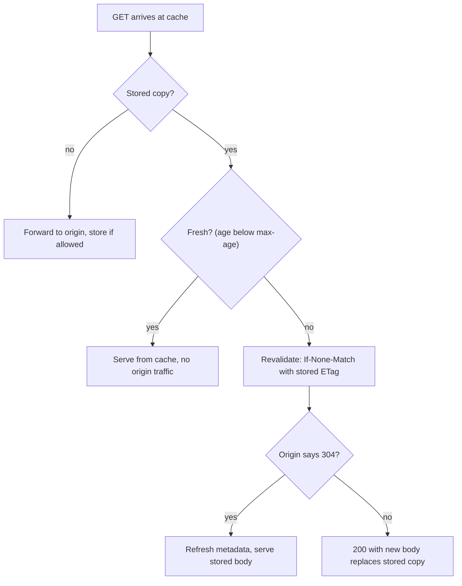

The starter's choices and the reason for each:

| Response | `Cache-Control` | Why |
| --- | --- | --- |
| `GET /api/v1/orders/{id}` | `private, no-cache` + `ETag` | Per-customer data must not sit in a CDN; revalidation makes repeat reads cost a 304. |
| `GET /api/v1/orders` | `private, no-cache` | Same data, changes on every write. |
| `POST` 201 | `no-store` | A creation result is not a reusable representation. |
| Problem Details | `no-store` | An error describes one moment; caching it would replay a transient 503 or 429. |
| `/health` | `no-store` | A probe must reach the live process every time. |

Only `GET` and `HEAD` responses are cached by default. A successful `PUT`, `PATCH`, `POST` or `DELETE` invalidates stored responses for that URI in caches the request passes through, but not in other caches such as other users' browsers, so short `max-age` values plus validators are safer than long TTLs for mutable data.

### 2.7 Headers Every REST API Uses

| Header | Direction | Example | Purpose |
| --- | --- | --- | --- |
| `Location` | Response | `Location: /api/v1/orders/ord_7f3a` | URI of the resource a `201` created, or the target of a redirect. |
| `Content-Location` | Response | `Content-Location: /api/v1/orders/ord_7f3a` | The URI of the representation in this body. |
| `Allow` | Response | `Allow: GET, POST, HEAD, OPTIONS` | Required with `405`; returned by `OPTIONS`. |
| `Accept-Patch` | Response | `Accept-Patch: application/merge-patch+json` | Patch formats a resource accepts. |
| `Link` | Response | `Link: </orders?cursor=x>; rel="next"` | Typed links (RFC 8288): pagination, deprecation, related docs. |
| `Retry-After` | Response | `Retry-After: 30` | Seconds (or a date) to wait after `429`, `503`, or a `3xx`. |
| `Vary` | Response | `Vary: Accept` | Request headers that select the representation; part of the cache key. |
| `ETag` / `Last-Modified` | Response | `ETag: "x"` | Validators for conditional requests. Prefer `ETag`; `Last-Modified` has one-second resolution. |
| `If-Match` / `If-None-Match` | Request | `If-Match: "x"` | Preconditions (2.5). |
| `Authorization` | Request | `Authorization: Bearer eyJ...` | Credentials (Stage 5). |
| `Idempotency-Key` | Request | `Idempotency-Key: 5f1e...` | Makes `POST` retry-safe ([M1](#m1-masterclass-idempotency-keys-for-safe-retries)). |
| `X-Request-Id` / `traceparent` | Both | `traceparent: 00-4bf9...-00f0...-01` | Correlation. `traceparent` is the W3C Trace Context standard used by OpenTelemetry. |

### 2.8 Pitfalls

| Pitfall | Symptom | Fix |
| --- | --- | --- |
| Side effects on `GET` (`GET /orders/42/cancel`) | Link prefetchers, crawlers or a browser's "reopen tabs" cancel real orders | Never change state on safe methods. |
| Treating `PATCH` as always idempotent | Retried JSON Patch `add` to `/items/-` duplicates a line item | Use merge patch or guard with `If-Match`; add an idempotency key for operation-style patches. |
| `200` for creation | Clients cannot find the new resource; no `Location` | Return `201` with `Location`. |
| `404` for a wrong method | Clients think the resource is gone and delete local copies | Return `405` with `Allow`. |
| `401` for "not permitted" | Clients drop a valid token and loop on re-login | `401` = no valid credentials; `403` = valid but not allowed. |
| Comparing `If-Match` weakly | A `W/` tag from a compressing proxy authorises a write on a different representation | Strong comparison for writes (`ifMatchHolds`). |
| Missing `Vary` on negotiated responses | A CDN serves CSV to a JSON client, or German to an English user | Add every negotiating header to `Vary`. |
| `no-cache` used to mean "do not store" | Sensitive data stays on disk in shared caches | `no-store` for secrets; `no-cache` only forces revalidation. |
| Caching error responses | A brief 503 is served to every user for the full TTL | `Cache-Control: no-store` on Problem Details. |
| `Content-Type: application/json` on error bodies | Clients cannot tell an error document from a resource without reading the status | Use `application/problem+json`. |

### 2.9 Best Practices

- **Pick the method from its properties, not its name**: if a retry must be safe, the method must be idempotent or carry an idempotency key.
- **Validate the result of a patch, not the patch**: one validation function for `PUT` and `PATCH` keeps the two consistent.
- **Return `ETag` on every cacheable representation**: it enables both 304s and lost-update protection at no design cost.
- **Accept `If-Match` on every write, and consider requiring it (`428`)**: concurrent editors are the norm in admin tools.
- **Serialise once, hash those bytes, send those bytes**: the tag and the body can never disagree.
- **Default to `private, no-cache` for authenticated reads and `no-store` for errors**: correct first, then relax per endpoint.
- **Advertise alternatives on rejection**: `Allow` with 405, `Accept-Patch` with 415, `Retry-After` with 429/503.

### 2.10 Hands-on Exercise

Prove the lost-update protection from the command line. Create an order, read its `ETag`, and send two `PATCH` requests with that same tag, as in the script in 2.5.

Expected output: the first `PATCH` returns `200` with a new `ETag`; the second returns `412` with a Problem Details body whose `type` ends in `precondition-failed`. Then extend the starter so that writes **require** a precondition: a `PUT`, `PATCH` or `DELETE` without `If-Match` should return `428 Precondition Required`. Change `checkIfMatch` in `src/orders/routes.ts`, and adapt the tests in `test/api.test.ts` (`a stale If-Match is 412`, `PUT is idempotent`) to send the header. The current behaviour and its tests are the reference point; your version should add one new test for the 428 case.

[Back to top ⤴️](#-table-of-contents)

---

## 3. Stage 3: Resource Modeling, URI Design, Filtering & Pagination

Methods and status codes are fixed by HTTP; the resources are yours to design, and they are the part of an API that is hardest to change later. This stage turns a domain into resources, URIs and representations, then covers the query features every collection needs. Prerequisite: Stage 2. Afterwards you can design a collection endpoint with filters, sorting, projections and pagination that stays fast at millions of rows.

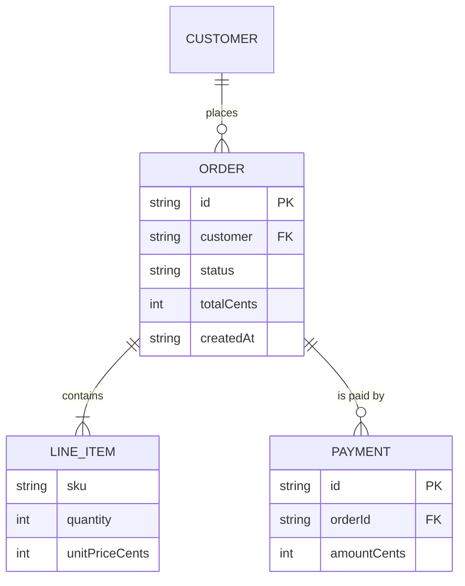

### 3.1 Identifying Resources

A resource is anything a client needs to name, read or change. It is not a database table: one table can back several resources, and one resource can join several tables. Start from what clients do, then name the nouns.

| Resource kind | URI shape | Example | Notes |
| --- | --- | --- | --- |
| Collection | `/orders` | List and create orders | Plural noun. `GET` lists, `POST` creates. |
| Item | `/orders/{id}` | One order | `GET`, `PUT`, `PATCH`, `DELETE`. |
| Sub-collection | `/orders/{id}/payments` | Payments of one order | Use when the child cannot exist without the parent. |
| Singleton sub-resource | `/orders/{id}/shipping-address` | The one address of an order | No ID segment; `GET`/`PUT` only. |
| Singleton top-level | `/me`, `/settings` | The caller's profile | Resolved from credentials. |
| Process or job | `/exports/{jobId}` | An async export | Represents work in progress (3.8). |
| Computed view | `/orders/summary?month=2026-10` | Aggregates | Read-only, often cacheable. |

The starter models a line item as part of the order, not as its own resource, because nobody needs to address one line item by URI. If clients later need to update line items independently, `/orders/{id}/items/{index}` can be added without breaking the existing order representation.

**Nesting depth.** Nest when the child's identity depends on the parent; flatten otherwise. A comment has a global ID, so `/comments/{commentId}` is better than `/orgs/1/projects/2/tasks/3/comments/4`, which forces clients to know four IDs to reach one comment and breaks when a task moves between projects. A practical limit is one level of nesting below a top-level item (`/tasks/{taskId}/comments`).

### 3.2 URI Design Rules

URIs are identifiers that clients bookmark, log and hard-code, so treat them as permanent.

| Rule | Do | Do not | Why |
| --- | --- | --- | --- |
| Nouns, not verbs | `DELETE /api/v1/users/42` | `POST /api/v1/deleteUser` | The method is the verb; intermediaries understand it. |
| Plural collections | `/api/v1/orders/42` | `/api/v1/order/42` | One consistent form; `/orders` lists, `/orders/42` is a member. |
| Lowercase, hyphenated | `/shipping-addresses` | `/shippingAddresses`, `/Shipping_Addresses` | Paths are case-sensitive; hyphens read well in URLs. |
| No file extensions | `Accept: text/csv` | `/orders.csv` | Format is negotiation, not identity (extensions are a pragmatic exception for downloads). |
| No trailing-slash meaning | `/orders` = `/orders/` | Two different resources | The starter's router treats both the same. |
| Opaque, stable IDs | `ord_c3c18b4961c34202a2a7` | `/orders/1001` (sequential) | Sequential IDs leak volume and invite enumeration. |
| Query for refinement | `/orders?status=paid` | `/orders/status/paid` | Filters are optional and combinable; paths are hierarchical. |
| Version once, at the root | `/api/v1/orders` | `/orders/v1`, per-endpoint versions | One version per contract (Stage 4). |

The starter generates IDs with a type prefix and 80 random bits:

```ts
// src/orders/store.ts
this.newId = options.newId ?? (() => `ord_${randomUUID().replaceAll('-', '').slice(0, 20)}`);
```

The prefix makes IDs self-describing in logs and support tickets (`ord_` vs `pay_`), and the random part prevents enumeration. If you need IDs that sort by creation time (for index locality), use UUIDv7 (RFC 9562), which puts a millisecond timestamp in the leading bits.

### 3.3 Modeling State and Actions

Not every operation is CRUD. "Cancel", "pay" and "ship" are state transitions. There are two REST-friendly ways to model them:

| Approach | Request | Good for | Cost |
| --- | --- | --- | --- |
| Update a state field | `PATCH /orders/42` with `{"status":"cancelled"}` | Simple lifecycles where the transition carries no extra data | Server must police legal transitions. |
| Create a sub-resource for the action | `POST /orders/42/cancellations` with `{"reason":"duplicate"}` | Transitions with their own data, audit trail or side effects (refunds) | More URIs; the cancellation becomes a resource you can `GET`. |

Avoid `POST /orders/42/cancel` with an empty body: it is RPC in a REST costume and gives nothing to `GET` afterwards. The starter uses the first approach and a state machine:

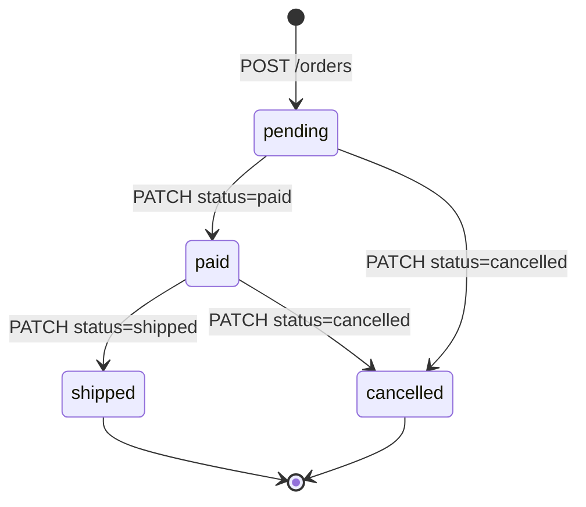

```ts
// src/orders/model.ts
const TRANSITIONS: Record<OrderStatus, readonly OrderStatus[]> = {
  pending: ['paid', 'cancelled'],
  paid: ['shipped', 'cancelled'],
  shipped: [],
  cancelled: [],
};

export function canTransition(from: OrderStatus, to: OrderStatus): boolean {
  return from === to || TRANSITIONS[from].includes(to);
}
```

```ts
// src/orders/routes.ts
function checkTransition(from: OrderStatus, to: OrderStatus): void {
  if (!canTransition(from, to)) {
    throw new HttpError(409, 'invalid-transition', 'Conflict', `An order that is ${from} cannot become ${to}.`, {
      extensions: { currentStatus: from },
    });
  }
}
```

| Line / API | Role | What happens at runtime |
| --- | --- | --- |
| `Record<OrderStatus, ...>` | Exhaustive table | Adding a status without listing its transitions is a compile error. |
| `from === to` | Idempotent no-op | Re-sending the current status succeeds, so retries are harmless. |
| `409` | State conflict | The request is valid but not now; 422 would wrongly suggest the input is malformed. |
| `currentStatus` extension | Recovery hint | The client can update its UI without another `GET`. |

```bash
curl -s -X PATCH localhost:8080/api/v1/orders/$ORDER \
  -H 'Content-Type: application/merge-patch+json' -d '{"status":"cancelled"}' | jq .status
curl -s -X PATCH localhost:8080/api/v1/orders/$ORDER \
  -H 'Content-Type: application/merge-patch+json' -d '{"status":"paid"}' | jq '{status, title, currentStatus}'
# { "status": 409, "title": "Conflict", "currentStatus": "cancelled" }
```

### 3.4 Designing Representations

A representation is the contract clients code against. Small choices here decide whether the API can evolve without breaking them.

```ts
// src/orders/routes.ts
export function represent(order: Order): Representation {
  const { version: _version, ...visible } = order;
  return {
    ...visible,
    _links: {
      self: { href: `${ORDERS}/${encodeURIComponent(order.id)}` },
      collection: { href: ORDERS },
    },
  };
}
```

```json
{
  "id": "ord_c3c18b4961c34202a2a7",
  "customer": "alice",
  "status": "pending",
  "items": [{ "sku": "BOOK-001", "quantity": 2, "unitPriceCents": 1500 }],
  "totalCents": 3000,
  "createdAt": "2026-11-03T04:27:05.106Z",
  "updatedAt": "2026-11-03T04:27:05.106Z",
  "_links": {
    "self": { "href": "/api/v1/orders/ord_c3c18b4961c34202a2a7" },
    "collection": { "href": "/api/v1/orders" }
  }
}
```

| Decision | Starter choice | Reasoning |
| --- | --- | --- |
| Internal fields | `version` is stripped | Storage details leak coupling; the `ETag` already carries the version. |
| Money | Integer `totalCents` | Binary floats cannot represent `0.10` exactly; add a `currency` field for multi-currency. |
| Timestamps | ISO 8601 UTC with `Z` | Unambiguous, sortable as strings, parsed by every language. |
| Derived values | `totalCents` computed by the server, read-only | Clients cannot send a total that disagrees with the items. |
| Field names | `camelCase` | Matches JavaScript clients; pick one style and never mix. |
| Optional values | `note` absent when unset | Absent and `null` mean different things in merge patch (`null` deletes). Document which one you emit. |
| Collections | Wrapped: `{ "data": [...], "page": {...} }` | A top-level array cannot grow metadata later without a breaking change. |
| Links | `_links` object | Clients navigate without building URIs; IDs stay opaque. |

The validator rejects server-owned fields instead of silently ignoring them. A client that sends `totalCents` has a bug, and telling it early beats storing data it thinks was saved:

```bash
curl -s -X POST localhost:8080/api/v1/orders -H 'Content-Type: application/json' \
  -d '{"customer":"","items":[],"totalCents":5}' | jq .errors
```

```json
[
  { "name": "totalCents", "reason": "is read-only" },
  { "name": "customer", "reason": "must be a non-empty string of at most 100 characters" },
  { "name": "items", "reason": "must be an array of 1 to 50 line items" }
]
```

### 3.5 Filtering, Sorting and Sparse Fieldsets

Collections need query features, and every one of them is a contract. Keep the vocabulary small and reject what you do not support: silently ignoring `?stauts=paid` returns unfiltered data that looks filtered.

| Feature | Starter syntax | Common alternatives | Rule |
| --- | --- | --- | --- |
| Equality filter | `?status=paid&customer=alice` | `?filter[status]=paid` (JSON:API) | One parameter per field; repeated filters are AND. |
| Range filter | (exercise) | `?createdAfter=2026-10-01`, `?totalCents[gte]=1000` | Name the bound explicitly; avoid ad-hoc operators. |
| Sort | `?sort=-createdAt` | `?sort=createdAt&order=desc` | `-` prefix for descending; only sort on indexed fields. |
| Projection | `?fields=status,totalCents` | GraphQL-style selection | `id` and `_links` always included. |
| Page size | `?limit=20` (1-100) | `?per_page=`, `?page[size]=` | Enforce a maximum; default to a safe value. |
| Search | `?q=` | `/search` resource, `QUERY` method | Full-text search is a different index; keep it separate from filters. |

The list handler collects every problem before failing, so a client sees all mistakes in one response:

```ts
// src/orders/routes.ts (excerpt)
const limitRaw = q.get('limit');
const limit = limitRaw === null ? DEFAULT_LIMIT : Number(limitRaw);
if (!Number.isInteger(limit) || limit < 1 || limit > MAX_LIMIT) {
  errors.push({ name: 'limit', reason: `must be an integer from 1 to ${MAX_LIMIT}` });
}

const status = q.get('status');
if (status !== null && !(ORDER_STATUSES as readonly string[]).includes(status)) {
  errors.push({ name: 'status', reason: `must be one of ${ORDER_STATUSES.join(', ')}` });
}

const sort = q.get('sort') ?? 'createdAt';
if (sort !== 'createdAt' && sort !== '-createdAt') {
  errors.push({ name: 'sort', reason: 'must be createdAt or -createdAt' });
}
// ... cursor and fields checks
if (errors.length > 0) throw invalidQuery(errors);
```

```bash
curl -s "localhost:8080/api/v1/orders?limit=0&status=lost&sort=price" | jq '{status, errors}'
```

```json
{
  "status": 400,
  "errors": [
    { "name": "limit", "reason": "must be an integer from 1 to 100" },
    { "name": "status", "reason": "must be one of pending, paid, shipped, cancelled" },
    { "name": "sort", "reason": "must be createdAt or -createdAt" }
  ]
}
```

Sparse fieldsets trim payloads for list screens that show two columns:

```bash
curl -s "localhost:8080/api/v1/orders?fields=status,totalCents&limit=2" | jq '.data'
```

```json
[
  { "id": "ord_c3c18b4961c34202a2a7", "status": "pending", "totalCents": 3000, "_links": { "self": { "href": "/api/v1/orders/ord_c3c18b4961c34202a2a7" }, "collection": { "href": "/api/v1/orders" } } },
  { "id": "ord_d0a9f2c4e1b84a7c9e31", "status": "pending", "totalCents": 899, "_links": { "self": { "href": "/api/v1/orders/ord_d0a9f2c4e1b84a7c9e31" }, "collection": { "href": "/api/v1/orders" } } }
]
```

Projection saves bandwidth and serialisation, but it only saves database work if the query layer also selects fewer columns. With an ORM that always loads full rows, the gain stops at the network.

### 3.6 Pagination: Offset vs Keyset

**Offset pagination** (`?page=1000&limit=20`, SQL `LIMIT 20 OFFSET 19980`) is simple and lets users jump to page N, but the database still walks and discards every skipped row, so cost grows with the offset. It also drifts: if a row is inserted on page 1 while a user reads page 2, the last row of page 2 reappears at the top of page 3.

**Keyset pagination** (also called cursor or seek pagination) remembers the sort key of the last row and asks for rows after it. With an index on the sort key, each page is an index seek plus a scan of `limit` rows: O(log n + limit), independent of how deep the client is. Inserts and deletes do not shift pages. The price: no "jump to page 500", and the sort key must be unique, which is why the starter sorts by `(createdAt, id)` rather than `createdAt` alone.

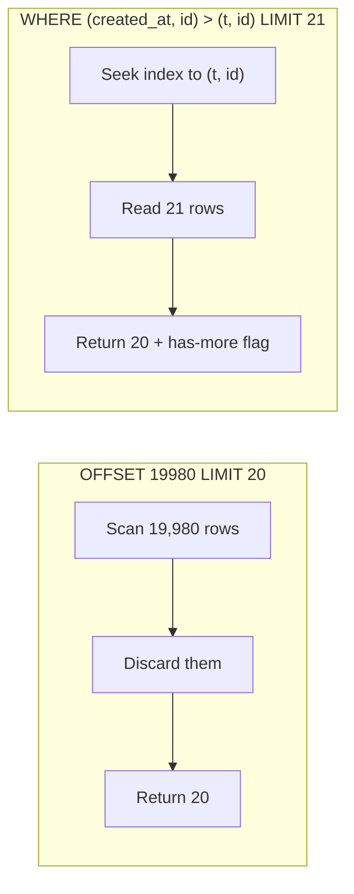

```sql
-- One composite index serves both the WHERE and the ORDER BY.
CREATE INDEX orders_created_id ON orders (created_at, id);

-- First page
SELECT id, customer, status, total_cents, created_at
FROM orders
WHERE status = 'pending'
ORDER BY created_at, id
LIMIT 21;                                   -- limit + 1

-- Next page: row-value comparison (PostgreSQL, MySQL 8, SQLite 3.15+)
SELECT id, customer, status, total_cents, created_at
FROM orders
WHERE status = 'pending'
  AND (created_at, id) > ('2026-11-03T04:27:05.106Z', 'ord_c3c18b4961c34202a2a7')
ORDER BY created_at, id
LIMIT 21;
```

The starter's in-memory version mirrors that query:

```ts
// src/http/pagination.ts
export function encodeCursor(key: SortKey): string {
  return Buffer.from(JSON.stringify([key.createdAt, key.id])).toString('base64url');
}

export function keysetPage<T extends SortKey>(
  rows: Iterable<T>,
  options: { limit: number; after?: SortKey | null; direction?: Direction },
): Page<T> {
  const sign = options.direction === 'desc' ? -1 : 1;
  const after = options.after ?? null;
  const sorted = [...rows].sort((a, b) => sign * compareKeys(a, b));
  const remaining = after ? sorted.filter((row) => sign * compareKeys(row, after) > 0) : sorted;
  const items = remaining.slice(0, options.limit);
  const last = items[items.length - 1];
  const nextCursor = remaining.length > options.limit && last ? encodeCursor(last) : null;
  return { items, nextCursor };
}
```

| Line / API | SQL equivalent | Why it matters |
| --- | --- | --- |
| `compareKeys` on `(createdAt, id)` | `ORDER BY created_at, id` | Ties on `createdAt` (several orders in one millisecond, as the seed data shows) are broken by `id`, so no row is skipped or repeated. |
| `sign` | `ASC` / `DESC` | One code path for both directions; the comparison flips. |
| `filter(... > 0)` | `WHERE (created_at, id) > (...)` | Strictly after the cursor; the last row of the previous page is not repeated. |
| `remaining.length > limit` | `LIMIT limit + 1` | Detects a next page without a `COUNT(*)`. |
| base64url JSON | opaque token | Clients treat it as a black box, so the server can change its contents later. |

The response carries the cursor three ways: in the body, as a body link, and as a `Link` header for clients that do not parse bodies:

```http
HTTP/1.1 200 OK
Content-Type: application/json
Cache-Control: private, no-cache
Link: </api/v1/orders?limit=2&cursor=WyIyMDI2LTExLTAz...>; rel="next"

{
  "data": [ ... ],
  "page": { "limit": 2, "nextCursor": "WyIyMDI2LTExLTAz..." },
  "_links": {
    "self": { "href": "/api/v1/orders?limit=2" },
    "next": { "href": "/api/v1/orders?limit=2&cursor=WyIyMDI2LTExLTAz..." }
  }
}
```

| | Offset | Keyset |
| --- | --- | --- |
| Cost of page N | Grows with N | Constant per page (index seek) |
| Stable under inserts/deletes | No: rows skip or repeat | Yes |
| Jump to arbitrary page | Yes | No (only next / previous) |
| Total count | Easy but expensive (`COUNT(*)`) | Usually omitted or estimated |
| Sort on any column | Yes | Only on indexed, unique (or tie-broken) keys |
| Best for | Small admin tables, numbered page UIs | Feeds, infinite scroll, exports, sync jobs, public APIs |

Cursors are not secrets. A client can decode the base64 and craft one, so validate the decoded shape (the starter returns `400` for anything it did not issue) and never put authorisation data in a cursor. If tampering matters, sign the cursor with an HMAC.

### 3.7 Hypermedia and Link Formats

Links let clients follow the API instead of hard-coding URI templates, which is what allows the server to change URI layouts or add pagination without client releases. The starter uses the HAL convention of a `_links` object; the root document advertises a URI template for items:

```json
{
  "name": "learn-rest-api orders service",
  "_links": {
    "self": { "href": "/" },
    "orders": { "href": "/api/v1/orders" },
    "order": { "href": "/api/v1/orders/{id}", "templated": true },
    "health": { "href": "/health" }
  }
}
```

| Format | Media type | Link shape | Strength | Weakness |
| --- | --- | --- | --- | --- |
| Plain JSON + `Link` header | `application/json` | `Link: <...>; rel="next"` | Works with any body; standard RFC 8288 | Headers are awkward for per-item links. |
| HAL | `application/hal+json` | `"_links": {"next": {"href": "..."}}` | Small, easy to adopt incrementally | No standard way to describe forms or methods. |
| JSON:API | `application/vnd.api+json` | `"links"`, `"relationships"`, compound documents | Strong conventions for filtering, includes, sparse fields | Heavy envelope; all-or-nothing adoption. |
| Siren | `application/vnd.siren+json` | `"links"` plus `"actions"` with method and fields | Describes actions, not just links | Little tooling support. |

Use registered relation types where they fit (`self`, `next`, `prev`, `first`, `last`, `collection`, `item`, `describedby`, `deprecation`) and URIs or a documented prefix for custom ones.

### 3.8 Bulk and Long-Running Operations

Some requests take longer than an HTTP timeout should: exports, imports, report generation. Do not hold the connection open. Accept the work, return a job resource, and let the client poll it (or subscribe to a webhook, [M2](#m2-masterclass-signed-webhook-delivery)).

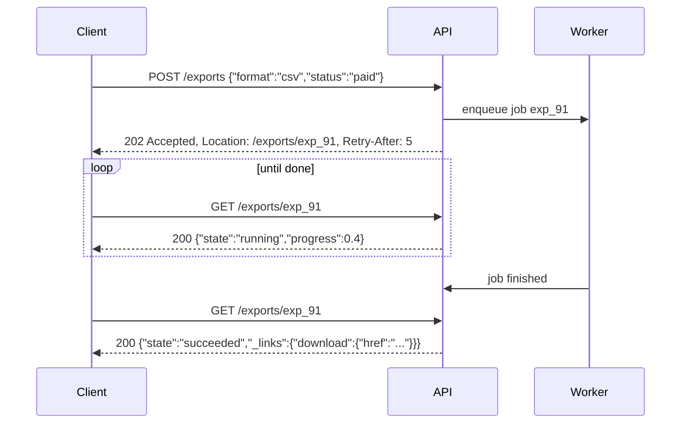

```http
HTTP/1.1 202 Accepted
Location: /api/v1/exports/exp_91
Retry-After: 5
Content-Type: application/json

{ "id": "exp_91", "state": "queued", "_links": { "self": { "href": "/api/v1/exports/exp_91" } } }
```

For bulk writes, choose between atomic and partial semantics explicitly:

| Style | Request | Response | Use when |
| --- | --- | --- | --- |
| Atomic batch | `POST /orders/batch` with N orders | `201` with all, or one `4xx` and nothing written | Items depend on each other |
| Partial batch | Same | `200` with a per-item result array (`status`, `id` or `problem`) | Items are independent; clients retry failures |
| Async batch | Same | `202` + job resource | Large batches |

HTTP has no standard "multi-status" response for JSON (WebDAV's `207` is XML-oriented), so document the per-item result format and keep the overall status honest: if nothing succeeded, do not return `200`.

### 3.9 Pitfalls

| Pitfall | Symptom | Fix |
| --- | --- | --- |
| Exposing table structure as resources | Every schema migration is a breaking API change | Design resources from client use cases; map in the service layer. |
| Sequential integer IDs | Competitors estimate order volume; attackers enumerate `/orders/1..N` | Opaque random IDs with a type prefix, or UUIDv7. |
| Deep nesting | `/orgs/1/projects/2/tasks/3/comments/4` breaks when a task moves | Flatten to `/comments/{id}` once a child has a global identity. |
| Floats for money | `0.1 + 0.2` gives `0.30000000000000004`; totals off by a cent | Integer minor units plus a currency code, or decimal strings. |
| Ignoring unknown query parameters | `?stauts=paid` returns every order; client thinks it is filtered | Reject unknown values with `400` and name the parameter. |
| Offset pagination on large tables | Page 5,000 takes seconds; `p99` grows over time; rows repeat during scrolling | Keyset pagination over an indexed, unique sort key. |
| Sorting by a non-unique key in keyset pagination | Rows with equal timestamps are skipped or duplicated at page boundaries | Add the primary key as a tie-breaker: `(created_at, id)`. |
| Unbounded `limit` | `?limit=1000000` exhausts memory | Enforce a maximum (the starter allows 1-100) and return `400` above it. |
| Top-level JSON arrays | Adding `nextCursor` later breaks every client | Always wrap collections in an object. |
| Synchronous long operations | Gateway `504` after 30 s, while the work continues and the client retries | `202 Accepted` with a job resource. |

### 3.10 Best Practices

- **Name resources after the domain, not the database**: clients should not notice a table split.
- **Keep URIs permanent and IDs opaque**: they end up in bookmarks, logs and other systems' databases.
- **Model transitions with a state machine and return `409` on illegal moves**: the rules live in one table, and clients get a precise error.
- **Wrap every collection and link every item**: the envelope is where future metadata goes.
- **Whitelist query parameters and fields**: an API that accepts anything cannot change anything.
- **Default to keyset pagination for anything that grows**: offset pagination fails gradually, which makes it easy to miss until it hurts.
- **Make cursors opaque and validated**: clients store them, so changing their format must not break clients, and garbage must fail cleanly.
- **Move long work out of the request**: `202` plus a job resource keeps timeouts and retries predictable.

### 3.11 Hands-on Exercise

Add a range filter to the starter: `GET /api/v1/orders?minTotalCents=1000` returns only orders whose `totalCents` is at least 1000, and it must combine correctly with `status`, `customer`, `sort` and cursors.

1. Validate the parameter in the list handler in `src/orders/routes.ts`: a non-negative integer, otherwise a `400` entry named `minTotalCents`.
2. Extend `ListFilter` and `OrderStore.list` in `src/orders/store.ts`.
3. Add a test to `test/api.test.ts` that walks every page of `?minTotalCents=1000&limit=1` and checks that each order qualifies and no ID repeats.

Expected output with the seed data on a fresh server: three orders (alice's `BOOK-001` order at 3000, alice's `PEN-007` order at 1200 and carol's `LAMP-310` order at 4999), one per page, and `?minTotalCents=-1` answers `400` with `errors[0].name == "minTotalCents"`. The existing pagination test (`walks all pages without duplicates and follows the Link header`) shows the page-walking pattern, and `src/http/pagination.ts` stays unchanged because filtering happens before the keyset step, just as a SQL `WHERE` clause would.

[Back to top ⤴️](#-table-of-contents)

---

## 4. Stage 4: Errors, Versioning & API Evolution

Once clients depend on an API, every change is a negotiation. This stage covers the error contract clients program against and the strategies for versioning a public API.

### 4.1 Comparison of Versioning Strategies

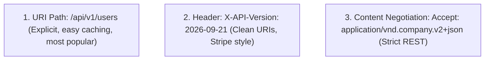

| Strategy | Example | Caching | Discoverability | Typical users |
| --- | --- | --- | --- | --- |
| URI path | `/api/v1/orders` | Works with any cache; the URI is the key | Visible in logs, docs and browser bars | Most public APIs |
| Custom request header | `X-API-Version: 2026-09-21` | CDN cache key must include the header (`Vary`) | Invisible in URLs; must be documented | Date-based versioning (Stripe-style) |
| Media type | `Accept: application/vnd.company.v2+json` | Needs `Vary: Accept` | Precise per representation | Strict hypermedia APIs |

### 4.2 Problem Details for HTTP APIs (RFC 9457)

Services should not invent a new error JSON shape per endpoint. RFC 9457 (which obsoleted RFC 7807 in July 2023 and keeps the same wire format) defines a machine-readable error document with the `application/problem+json` media type. The members `type`, `title`, `status`, `detail` and `instance` are standard; anything else, such as `invalidParams` below, is an extension member that clients may ignore:

```http
HTTP/1.1 409 Conflict
Content-Type: application/problem+json
Content-Language: en

{
  "type": "https://api.example.com/errors/insufficient-credit",
  "title": "Insufficient Account Balance",
  "status": 409,
  "detail": "Your balance of $12.50 is insufficient for this $49.00 transaction.",
  "instance": "/api/v1/accounts/acc-891/transfers",
  "invalidParams": [
    {
      "name": "amountCents",
      "reason": "Amount exceeds available spending limit"
    }
  ],
  "balance": 1250,
  "required": 4900
}
```

The starter emits the same shape from `src/http/problem.ts`, with an `errors` extension for validation failures.

### 4.3 A Global Problem Details Error Responder (Express)

In an Express service, one error-handling middleware can turn every thrown error into Problem Details. Zod validation errors become `422` with per-field reasons, domain errors carry their own status and type, and anything unexpected becomes a `500` that hides internals in production:

```ts
// src/middleware/problemDetails.ts
import { Request, Response, NextFunction, ErrorRequestHandler } from 'express';
import { ZodError } from 'zod';

export class DomainError extends Error {
  public readonly status: number;
  public readonly codeType: string;
  public readonly invalidParams?: Array<{ name: string; reason: string }>;

  constructor(title: string, status: number, detail: string, codeType?: string, invalidParams?: Array<{ name: string; reason: string }>) {
    super(detail);
    this.name = title;
    this.status = status;
    this.codeType = codeType || 'https://api.example.com/errors/general';
    this.invalidParams = invalidParams;
  }
}

export const problemDetailsHandler: ErrorRequestHandler = (err, req: Request, res: Response, next: NextFunction) => {
  res.setHeader('Content-Type', 'application/problem+json');

  // Handle Zod Schema Validation Errors
  if (err instanceof ZodError) {
    const invalidParams = err.issues.map((issue) => ({
      name: issue.path.join('.'),
      reason: issue.message,
    }));

    return res.status(422).json({
      type: 'https://api.example.com/errors/validation-failed',
      title: 'Unprocessable Content',
      status: 422,
      detail: 'The submitted request payload failed schema validation constraints.',
      instance: req.originalUrl,
      invalidParams,
    });
  }

  // Handle Custom Domain Errors
  if (err instanceof DomainError) {
    return res.status(err.status).json({
      type: err.codeType,
      title: err.name,
      status: err.status,
      detail: err.message,
      instance: req.originalUrl,
      invalidParams: err.invalidParams,
    });
  }

  // Internal Server Error Fallback
  const isProd = process.env.NODE_ENV === 'production';
  console.error(`[Unhandled Error] ${req.method} ${req.originalUrl}:`, err);

  return res.status(500).json({
    type: 'https://api.example.com/errors/internal-server-error',
    title: 'Internal Server Error',
    status: 500,
    detail: isProd ? 'An unexpected server error occurred.' : err.message,
    instance: req.originalUrl,
    ...(isProd ? {} : { stack: err.stack }),
  });
};
```

[Back to top ⤴️](#-table-of-contents)

---

## 5. Stage 5: Security, Rate Limiting & Hardening

Public APIs must protect themselves from abusive clients and from browsers acting on behalf of other sites. This stage covers rate limiting and CORS.

### 5.1 Sliding-Window Rate Limiter with RateLimit Headers

A sliding-log limiter keeps one Redis sorted-set entry per request and counts the entries inside the window. The pipeline below removes expired entries, records the current request and counts, all in one round trip. The `RateLimit-Limit`, `RateLimit-Remaining` and `RateLimit-Reset` names come from an earlier revision of the IETF httpapi RateLimit header draft; later revisions replace them with `RateLimit-Policy` and `RateLimit` structured fields, so pin and document the revision you implement:

```ts
// src/middleware/rateLimiter.ts
import { Request, Response, NextFunction } from 'express';
import Redis from 'ioredis';

const redis = new Redis(process.env.REDIS_URL!);

export interface RateLimitOptions {
  windowMs: number; // e.g. 60,000 ms (1 minute)
  maxRequests: number; // e.g. 100 requests per window
}

export function rateLimiter(options: RateLimitOptions) {
  const { windowMs, maxRequests } = options;

  return async (req: Request, res: Response, next: NextFunction) => {
    // Identify client by authenticated API key, user ID, or IP address
    const clientId = (req.headers['x-api-key'] as string) || req.ip || 'anonymous';
    const now = Date.now();
    const clearBefore = now - windowMs;
    const redisKey = `ratelimit:${clientId}`;

    // Execute atomic Redis pipeline: purge old requests, add current, count remaining
    const multi = redis.multi();
    multi.zremrangebyscore(redisKey, 0, clearBefore);
    multi.zadd(redisKey, now, `${now}-${Math.random()}`);
    multi.zcard(redisKey);
    multi.expire(redisKey, Math.ceil(windowMs / 1000));

    const results = await multi.exec();
    const currentCount = results ? (results[2][1] as number) : 1;
    const remaining = Math.max(0, maxRequests - currentCount);
    const resetTimeSeconds = Math.ceil(windowMs / 1000);

    // Set IETF draft rate limiting headers
    res.setHeader('RateLimit-Limit', maxRequests);
    res.setHeader('RateLimit-Remaining', remaining);
    res.setHeader('RateLimit-Reset', resetTimeSeconds);

    if (currentCount > maxRequests) {
      res.setHeader('Retry-After', resetTimeSeconds);
      return res.status(429).json({
        type: 'https://api.example.com/errors/rate-limit-exceeded',
        title: 'Too Many Requests',
        status: 429,
        detail: `Rate limit of ${maxRequests} requests per ${windowMs / 1000}s exceeded.`,
        instance: req.originalUrl,
        retryAfterSeconds: resetTimeSeconds,
      });
    }

    next();
  };
}
```

### 5.2 Production CORS Configuration

CORS is enforced by browsers, not servers: the server only declares which origins, methods and headers a cross-origin page may use. This configuration allows two known origins, lists the custom request headers the API accepts (`Idempotency-Key`, `If-Match`), exposes the response headers clients need to read (`Location`, `ETag`, rate-limit headers), and caches preflight results for a day:

```ts
// src/middleware/cors.ts
import cors from 'cors';

const allowedOrigins = [
  'https://platform.internal',
  'https://admin.platform.internal',
];

export const corsConfig = cors({
  origin: (origin, callback) => {
    // Allow server-to-server or non-browser requests without origin header
    if (!origin || allowedOrigins.includes(origin)) {
      callback(null, true);
    } else {
      callback(new Error('Cross-Origin Request Blocked by CORS Policy.'));
    }
  },
  methods: ['GET', 'POST', 'PUT', 'PATCH', 'DELETE', 'OPTIONS'],
  allowedHeaders: [
    'Content-Type',
    'Authorization',
    'Idempotency-Key',
    'X-API-Key',
    'X-Correlation-ID',
    'If-Match',
    'If-None-Match',
  ],
  exposedHeaders: [
    'Location',
    'ETag',
    'RateLimit-Limit',
    'RateLimit-Remaining',
    'RateLimit-Reset',
    'Retry-After',
  ],
  credentials: true,
  maxAge: 86400, // Cache preflight response for 24 hours
});
```

[Back to top ⤴️](#-table-of-contents)

---

## 6. Stage 6: OpenAPI, Contract Testing & Tooling

A REST API's contract should be written down in a form tools can check. This stage covers OpenAPI documents and the tests that hold an implementation to them.

### 6.1 OpenAPI 3.1 Document Example (`openapi.yaml`)

The document below describes a paginated collection with a reusable schema and a shared Problem Details error response. In OpenAPI 3.1, everything under `schema` is standard JSON Schema 2020-12:

```yaml
openapi: 3.1.0
info:
  title: Production Cluster Telemetry API
  version: 1.0.0
  description: High-throughput distributed cluster management endpoints.
paths:
  /api/v1/services:
    get:
      summary: List microservices with health status
      operationId: listServices
      parameters:
        - name: limit
          in: query
          required: false
          schema:
            type: integer
            default: 20
        - name: cursor
          in: query
          required: false
          schema:
            type: string
      responses:
        '200':
          description: Successful paginated list of services.
          content:
            application/json:
              schema:
                type: object
                required: [data, pagination]
                properties:
                  data:
                    type: array
                    items:
                      $ref: '#/components/schemas/Service'
                  pagination:
                    type: object
                    required: [hasMore]
                    properties:
                      hasMore:
                        type: boolean
                      nextCursor:
                        type: string
        '401':
          $ref: '#/components/responses/UnauthorizedError'

components:
  schemas:
    Service:
      type: object
      required: [id, name, status, p99LatencyMs]
      properties:
        id:
          type: string
          format: uuid
        name:
          type: string
        status:
          type: string
          enum: [HEALTHY, DEGRADED, FAILING]
        p99LatencyMs:
          type: number
  responses:
    UnauthorizedError:
      description: Authentication credentials missing or invalid.
      content:
        application/problem+json:
          schema:
            type: object
            required: [type, title, status]
            properties:
              type:
                type: string
              title:
                type: string
              status:
                type: integer
                example: 401
```

### 6.2 Contract Tests with Supertest and Vitest

These tests assert the parts of the contract clients depend on: status codes, content types, envelope shape, idempotent replay and the Problem Details error format. The starter's `test/api.test.ts` covers the same ground with `node:test` and `fetch` against a real server instead of Supertest:

```ts
// tests/api/orders.spec.ts
import { describe, it, expect } from 'vitest';
import request from 'supertest';
import { app } from '../../src/app';

describe('Orders RESTful Endpoint Contract Suite', () => {
  it('GET /api/v1/orders returns 200 with keyset pagination contract', async () => {
    const res = await request(app)
      .get('/api/v1/orders?limit=10')
      .set('Accept', 'application/json');

    expect(res.status).toBe(200);
    expect(res.headers['content-type']).toMatch(/application\/json/);
    expect(res.body).toHaveProperty('data');
    expect(res.body).toHaveProperty('pagination');
    expect(Array.isArray(res.body.data)).toBe(true);
  });

  it('POST /api/v1/orders with duplicate Idempotency-Key returns replayed 201 response', async () => {
    const idempotencyKey = `idemp-${Date.now()}`;
    const payload = { customerId: 'cust-101', amountCents: 2500 };

    // 1. Initial Request
    const res1 = await request(app)
      .post('/api/v1/orders')
      .set('Idempotency-Key', idempotencyKey)
      .send(payload);

    expect(res1.status).toBe(201);
    expect(res1.headers['location']).toBeDefined();

    // 2. Duplicate Retried Request
    const res2 = await request(app)
      .post('/api/v1/orders')
      .set('Idempotency-Key', idempotencyKey)
      .send(payload);

    expect(res2.status).toBe(201);
    expect(res2.headers['x-cache-replay']).toBe('true');
    expect(res2.body.data.id).toBe(res1.body.data.id);
  });

  it('POST /api/v1/orders with invalid payload returns RFC 9457 problem details', async () => {
    const res = await request(app)
      .post('/api/v1/orders')
      .send({ amountCents: -50 }); // Negative amount invalid

    expect(res.status).toBe(422);
    expect(res.headers['content-type']).toMatch(/application\/problem\+json/);
    expect(res.body).toHaveProperty('type');
    expect(res.body).toHaveProperty('title');
    expect(res.body).toHaveProperty('invalidParams');
  });
});
```

### 6.3 Reference Express CRUD Router with Zod Validation

A complete Express router that applies the rules from Stages 2 and 3: Zod schemas for input, `201` with `Location` on create, weak `ETag` plus `304` on read, `204` on delete, and errors forwarded to the Problem Details responder from 4.3:

```ts
// src/routes/order.routes.ts
import { Router, Request, Response, NextFunction } from 'express';
import { z } from 'zod';
import { idempotencyMiddleware } from '../middleware/idempotency';
import { rateLimiter } from '../middleware/rateLimiter';

const router = Router();

// Validation Schemas
const CreateOrderSchema = z.object({
  customerId: z.string().uuid(),
  items: z.array(
    z.object({
      productId: z.string().uuid(),
      quantity: z.number().int().positive(),
      unitPriceCents: z.number().int().nonnegative(),
    })
  ).min(1, 'Order must contain at least one item'),
});

const PatchOrderSchema = z.object({
  status: z.enum(['PENDING', 'PROCESSING', 'SHIPPED', 'CANCELLED']).optional(),
  shippingAddress: z.string().min(5).optional(),
});

// 1. GET /api/v1/orders - Paginated Collection Seek
router.get('/orders', rateLimiter({ windowMs: 60000, maxRequests: 120 }), async (req: Request, res: Response, next: NextFunction) => {
  try {
    const limit = Math.min(parseInt(req.query.limit as string) || 20, 100);
    const cursor = req.query.cursor as string;

    // Database lookup simulation
    const orders = [
      { id: '9a1e4b21-4f10-4d32-8411-9a7b1c3d5e21', customerId: 'c1', totalCents: 4500, status: 'PROCESSING' },
    ];

    return res.status(200).json({
      data: orders,
      pagination: {
        limit,
        hasMore: false,
        nextCursor: null,
      },
    });
  } catch (err) {
    next(err);
  }
});

// 2. GET /api/v1/orders/:id - Single Resource Read with ETag Caching
router.get('/orders/:id', async (req: Request, res: Response, next: NextFunction) => {
  try {
    const { id } = req.params;
    const order = { id, customerId: 'c1', totalCents: 4500, status: 'PROCESSING', version: 2 };

    const etag = `W/"ord-${id}-v${order.version}"`;
    if (req.headers['if-none-match'] === etag) {
      return res.status(304).end(); // 304 Not Modified
    }

    res.setHeader('ETag', etag);
    res.setHeader('Cache-Control', 'private, max-age=60');
    return res.status(200).json({ data: order });
  } catch (err) {
    next(err);
  }
});

// 3. POST /api/v1/orders - Creation with Idempotency Protection
router.post('/orders', idempotencyMiddleware(86400), async (req: Request, res: Response, next: NextFunction) => {
  try {
    const validated = CreateOrderSchema.parse(req.body);
    const newOrderId = 'b23e4a91-7d12-4c89-a123-f9d8c7b6a5e4';

    const createdOrder = {
      id: newOrderId,
      ...validated,
      status: 'PENDING',
      createdAt: new Date().toISOString(),
    };

    // Location header informs client where to fetch newly created resource
    res.setHeader('Location', `/api/v1/orders/${newOrderId}`);
    return res.status(201).json({
      data: createdOrder,
      _links: {
        self: { href: `/api/v1/orders/${newOrderId}` },
        cancel: { href: `/api/v1/orders/${newOrderId}`, method: 'DELETE' },
      },
    });
  } catch (err) {
    next(err);
  }
});

// 4. PATCH /api/v1/orders/:id - Partial Modification
router.patch('/orders/:id', async (req: Request, res: Response, next: NextFunction) => {
  try {
    const { id } = req.params;
    const validated = PatchOrderSchema.parse(req.body);

    const updatedOrder = {
      id,
      ...validated,
      updatedAt: new Date().toISOString(),
    };

    return res.status(200).json({ data: updatedOrder });
  } catch (err) {
    next(err);
  }
});

// 5. DELETE /api/v1/orders/:id - Idempotent Deletion
router.delete('/orders/:id', async (req: Request, res: Response, next: NextFunction) => {
  try {
    const { id } = req.params;
    // Database delete simulation
    console.log(`Soft-deleting order ${id}`);

    // Return 204 No Content for successful mutation without response body
    return res.status(204).end();
  } catch (err) {
    next(err);
  }
});

export default router;
```

[Back to top ⤴️](#-table-of-contents)

---

## M1. Masterclass: Idempotency Keys for Safe Retries

`POST` is not idempotent, so a client that times out cannot know whether its order or payment went through. An idempotency key lets it retry safely: the server stores the first outcome under a client-chosen key and replays it for every retry. The header follows the IETF httpapi Idempotency-Key draft and the pattern popularised by payment APIs.

### M1.1 How the Idempotency-Key Protocol Works

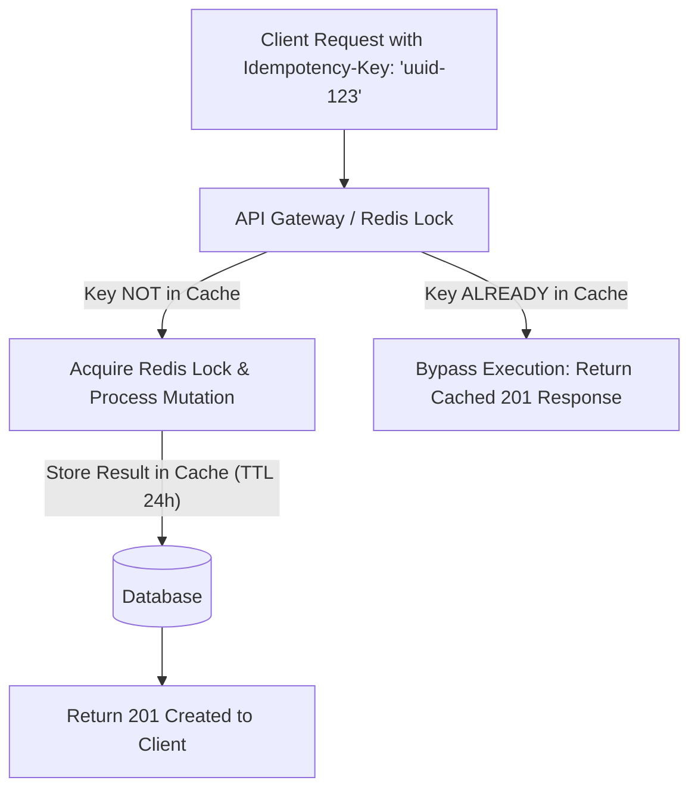

The starter implements the single-process version in `src/http/idempotency.ts`: it fingerprints the method, path and body, replays the stored `201` with `Idempotent-Replayed: true`, and returns `422` when a key is reused with a different body.

### M1.2 Express Middleware Backed by Redis

This middleware caches the status, headers and body of every non-5xx response under the key for 24 hours. Note what it does not do yet: it has no lock, so two concurrent requests with the same key can both execute. A production version claims the key atomically first (`SET key "in-flight" NX PX ttl`), returns `409 Conflict` to a concurrent duplicate, and also fingerprints the request body:

```ts
// src/middleware/idempotency.ts
import { Request, Response, NextFunction } from 'express';
import Redis from 'ioredis';

const redis = new Redis(process.env.REDIS_URL!);

export function idempotencyMiddleware(ttlSeconds: number = 86400) {
  return async (req: Request, res: Response, next: NextFunction) => {
    // Idempotency keys are only relevant for mutation methods
    if (['GET', 'HEAD', 'OPTIONS'].includes(req.method)) {
      return next();
    }

    const key = req.headers['idempotency-key'] as string;
    if (!key) {
      return next(); // Or enforce: return res.status(400).json({ error: 'Missing Idempotency-Key' });
    }

    const cacheKey = `idempotency:${req.originalUrl}:${key}`;
    const cachedResponse = await redis.get(cacheKey);

    if (cachedResponse) {
      const parsed = JSON.parse(cachedResponse);
      return res.status(parsed.status).set(parsed.headers).set('X-Cache-Replay', 'true').send(parsed.body);
    }

    // Intercept res.send to cache response
    const originalSend = res.send.bind(res);
    res.send = (body: any): Response => {
      // Only cache successful or client error responses (don't cache 500s)
      if (res.statusCode < 500) {
        redis.set(
          cacheKey,
          JSON.stringify({
            status: res.statusCode,
            headers: res.getHeaders(),
            body,
          }),
          'EX',
          ttlSeconds
        );
      }
      return originalSend(body);
    };

    next();
  };
}
```

[Back to top ⤴️](#-table-of-contents)

---

## M2. Masterclass: Signed Webhook Delivery

Webhooks reverse the direction of a REST call: the API becomes the client and `POST`s events to a URL the subscriber registered. The receiver must be able to prove the request came from you and was not replayed.

### M2.1 Webhook Delivery Worker with HMAC-SHA256 Signatures

The worker signs `timestamp.body` with a shared secret, sends the timestamp and signature in one header, and retries with exponential backoff. Including the timestamp in the signed payload lets receivers reject old deliveries, which defeats replay of captured requests:

```ts
// src/services/webhook.service.ts
import crypto from 'crypto';

export interface WebhookEventPayload {
  eventId: string;
  eventType: 'order.created' | 'order.fulfilled' | 'payment.failed';
  timestamp: string;
  data: Record<string, any>;
}

export async function dispatchWebhookWithSignature(
  destinationUrl: string,
  secretKey: string,
  payload: WebhookEventPayload,
  maxRetries: number = 3
): Promise<boolean> {
  const bodyString = JSON.stringify(payload);
  const timestamp = Math.floor(Date.now() / 1000).toString();

  // Compute HMAC SHA256 signature using timestamp and body (prevents replay attacks)
  const signaturePayload = `t=${timestamp},v1=${crypto
    .createHmac('sha256', secretKey)
    .update(`${timestamp}.${bodyString}`)
    .digest('hex')}`;

  for (let attempt = 1; attempt <= maxRetries; attempt++) {
    try {
      const response = await fetch(destinationUrl, {
        method: 'POST',
        headers: {
          'Content-Type': 'application/json',
          'User-Agent': 'HubScale-Webhook-Worker/1.0',
          'X-Hub-Signature-256': signaturePayload,
          'X-Event-ID': payload.eventId,
        },
        body: bodyString,
        signal: AbortSignal.timeout(5000), // 5s timeout
      });

      if (response.ok) {
        console.log(`Webhook ${payload.eventId} successfully delivered to ${destinationUrl}`);
        return true;
      }
    } catch (err) {
      console.warn(`Webhook delivery attempt ${attempt} failed:`, err);
    }

    // Exponential backoff wait (1s, 2s, 4s)
    await new Promise((res) => setTimeout(res, 1000 * 2 ** (attempt - 1)));
  }

  console.error(`Failed to deliver webhook ${payload.eventId} after ${maxRetries} attempts.`);
  return false;
}
```

[Back to top ⤴️](#-table-of-contents)

---

## 7. Stage 7: Staff REST API Architect Interview Handbook & Cheatsheet

Fifty questions that come up in API design and backend interviews, grouped from fundamentals to scenarios.

### 7.1 Core Concepts (Q1-Q10)

#### Q1. What is the Richardson Maturity Model and what criteria distinguish Level 2 from Level 3?

The Richardson Maturity Model grades APIs on REST conformance across four levels: Level 0 (single URI and method, e.g. XML-RPC/SOAP), Level 1 (individual resource URIs), Level 2 (proper HTTP verbs and standard status codes), and Level 3 (Hypermedia Controls / HATEOAS). Level 2 APIs use resources, verbs (`GET`, `POST`, `PUT`, `DELETE`), and status codes, but responses contain only raw data. Level 3 APIs include hypermedia controls (`_links`), where each response contains navigational links guiding the client on what actions and transitions are valid from the current state.

#### Q2. What is the architectural difference between `PUT` and `PATCH`?

`PUT` implies full replacement: the client sends a complete representation of the resource. If optional fields are omitted from the payload, the server is expected to clear or reset them to defaults. `PATCH` (RFC 5789) is intended for partial modification: the client sends only the fields that need updating, leaving all unmentioned properties intact.

#### Q3. Why is `PATCH` classified as non-idempotent by the HTTP specification?

While simple field overwrite patches can be idempotent, `PATCH` can describe mutations that are non-idempotent by definition. For instance, using JSON Patch (RFC 6902) with an `add` operation appending an element to an array (`{ "op": "add", "path": "/items/-", "value": "new_item" }`), sending the request twice appends the item twice, changing the server state on the second request.

#### Q4. How does an Idempotency-Key header work in high-volume payment processing?

The client generates a unique UUID (`Idempotency-Key`) and includes it in the header of a `POST` request. The API gateway or backend acquires an atomic lock in an in-memory store (e.g., Redis) on that key. If a concurrent or retried request arrives with the same key while processing, it waits or receives `409 Conflict`. When processing completes, the server caches the response status code, headers, and body in Redis with a TTL (e.g., 24 hours). Subsequent retried requests immediately return the cached response without re-executing business logic or charging cards twice.

#### Q5. What is the difference between `200 OK`, `201 Created`, `202 Accepted`, and `204 No Content`?

- `200 OK`: Request succeeded and the response body contains representation data.
- `201 Created`: Request succeeded, a new resource was created, and its URI is provided in the `Location` header.
- `202 Accepted`: Request accepted for asynchronous processing; execution has not completed yet (ideal for long-running batch jobs).
- `204 No Content`: Request succeeded and server fulfilled the action, but intentionally returns an empty response body (common for `DELETE` and `PUT` operations).

#### Q6. How does the HTTP `ETag` (Entity Tag) header enable optimistic concurrency control?

The server generates a cryptographic hash or version tag of the resource representation and sends it in the `ETag: "v1-hash"` header on `GET`. When the client later modifies the resource via `PUT` or `PATCH`, it sends the tag in the `If-Match: "v1-hash"` header. If another client modified the resource in the meantime, the ETag on the server changed, and the server rejects the update with `412 Precondition Failed`, preventing lost updates.

#### Q7. What is the difference between URI Path versioning and Header versioning?

URI path versioning (`/api/v1/orders`) is explicit, transparent, works easily with CDNs/browser caching, and is the most widely adopted industry standard. Header versioning (`X-API-Version: 2026-09-21` or `Accept: application/vnd.company.v1+json`) preserves clean, stable URIs across releases, but requires custom CDN cache key configuration (adding the version header to cache vary keys).

#### Q8. What is RFC 9457 (Problem Details for HTTP APIs), and how does it relate to RFC 7807?

RFC 9457 obsoleted RFC 7807 in July 2023 without changing the wire format. Both define a standard JSON payload for API errors (`Content-Type: application/problem+json`). It replaces arbitrary error contracts with standard keys: `type` (URI identifier), `title` (human-readable summary), `status` (HTTP status code), `detail` (specific explanation of occurrence), and `instance` (URI where error occurred).

#### Q9. What is the purpose of HTTP `HEAD` requests?

A `HEAD` request is identical to a `GET` request, but the server must not return a message body. It is used to check resource existence, verify last-modified timestamps, or inspect `Content-Length` headers before downloading multi-gigabyte files.

#### Q10. What is the difference between `401 Unauthorized` and `403 Forbidden`?

`401 Unauthorized` means unauthenticated: the client has not provided valid credentials or authentication tokens. `403 Forbidden` means authenticated but unauthorized: the server knows the client's identity, but the client does not have permission to access the requested resource.

### 7.2 Internals & Performance (Q11-Q20)

#### Q11. How do you design rate limiting headers in a public REST API?

Standard industry headers include:
- `RateLimit-Limit`: Maximum requests permitted within the time window.
- `RateLimit-Remaining`: Number of requests left in the active window.
- `RateLimit-Reset`: Number of seconds until the rate limit window resets.
- When exceeded, the server returns status `429 Too Many Requests` with a `Retry-After: 30` header.

These three names come from an earlier revision of the IETF httpapi RateLimit header draft. Later revisions replace them with `RateLimit-Policy` and `RateLimit` structured fields, so pin the revision you implement and document it.

#### Q12. What is the difference between `POST /items` and `PUT /items/123`?

`POST` creates a subordinate resource under the parent collection, and the server assigns the new resource identifier (e.g., returning `/items/124`). `PUT` acts directly on a known resource URI (`/items/123`), creating or replacing the resource at that exact URI.

#### Q13. Why should REST APIs avoid returning top-level JSON arrays?

Returning top-level arrays (`[{ ... }, { ... }]`) limits future extensibility. If you later need to return pagination metadata, facets, or debug tokens, wrapping items in an object (`{ "data": [...], "pagination": { ... } }`) allows backward-compatible field additions without breaking existing clients.

#### Q14. How does CORS (Cross-Origin Resource Sharing) work with preflight requests?

For non-simple requests (requests with custom headers like `Authorization`, or methods other than `GET`, `HEAD`, `POST`), the browser automatically sends an HTTP `OPTIONS` request to the server with `Origin` and `Access-Control-Request-Method` headers. The server must respond with `Access-Control-Allow-Origin`, `Access-Control-Allow-Methods`, and `Access-Control-Allow-Headers` before the browser executes the actual request.

#### Q15. What is Content Negotiation in REST?

The mechanism where client and server agree on the representation format of a resource. The client sends `Accept: application/json, text/csv` and `Accept-Language: en-US`. The server inspects capabilities and responds with the preferred format indicated by the `Content-Type` header.

#### Q16. What is the purpose of the `Location` header in REST responses?

Following a `201 Created` response, the `Location` header provides the absolute or relative URL to the newly created resource (e.g., `Location: /api/v1/orders/ord-9921`).

#### Q17. What does `Cache-Control: no-cache` mean vs `no-store`?

`no-store` forbids the browser and intermediaries from saving any copy of the response in cache. `no-cache` allows storing the response, but mandates that the client must revalidate with the origin server (using `ETag` or `If-Modified-Since`) before serving the cached copy.

#### Q18. What is HATEOAS and how is it implemented in JSON?

Hypermedia As The Engine Of Application State. Responses contain a `_links` object describing possible state transitions:
```json
{
  "id": "ord-1",
  "status": "PENDING",
  "_links": {
    "self": { "href": "/orders/ord-1" },
    "cancel": { "href": "/orders/ord-1/cancel", "method": "POST" }
  }
}
```

#### Q19. What is the difference between `PUT` and `POST` for idempotent operations?

Repeating `PUT /users/42` with `{ "name": "Alice" }` five times leaves the user's name as "Alice" every time (idempotent). Repeating `POST /orders` five times creates five separate orders (non-idempotent).

#### Q20. How do you handle file uploads in REST APIs?

1. Direct multipart upload using `Content-Type: multipart/form-data`.
2. Presigned S3/GCS URLs (Recommended): Client requests an upload token from the API, then uploads binary directly to cloud storage, notifying the API upon completion.

### 7.3 Architecture & Design (Q21-Q30)

#### Q21. What is the role of the `Vary` header?

Informs caches that the response representation varies based on specified request headers (e.g., `Vary: Accept-Encoding, X-API-Version`), preventing a client requesting JSON from receiving cached XML.

#### Q22. What is the difference between soft deletes and hard deletes in REST API design?

A hard delete physically removes the database row (`DELETE /items/1`). A soft delete sets a `deleted_at` timestamp in the database, but returns `204 No Content` to the client and causes subsequent `GET /items/1` calls to return `404 Not Found` or `410 Gone`.

#### Q23. When should an API return `410 Gone` instead of `404 Not Found`?

`404 Not Found` indicates the resource does not exist (and might never have existed). `410 Gone` explicitly signals that the resource previously existed, was intentionally deleted, and will not return, instructing search engines and clients to purge cached links.

#### Q24. What is JSON Patch (RFC 6902)?

A format for expressing a sequence of operations to apply to a JSON document (`add`, `remove`, `replace`, `move`, `copy`, `test`) using `Content-Type: application/json-patch+json`.

#### Q25. What is JSON Merge Patch (RFC 7396)?

A simplified partial update format where sending `{ "name": "Elena", "role": null }` updates `name` to "Elena" and deletes the `role` field.

#### Q26. How do you implement field projection (sparse fieldsets)?

Using a query parameter like `?fields=id,email,status`. The server queries and serializes only the requested columns, reducing serialization CPU and network payload size.

#### Q27. How do you implement full-text search endpoints RESTfully?

`GET /api/v1/articles?q=distributed+systems&sort=-relevance`.

#### Q28. What is the purpose of `304 Not Modified`?

Returned when a client performs a conditional `GET` with `If-None-Match` or `If-Modified-Since` and the resource has not changed. The server sends zero body payload, saving bandwidth.

#### Q29. How do you document REST APIs with OpenAPI / Swagger?

Write an OpenAPI 3.1 YAML/JSON specification detailing paths, methods, request bodies, query parameters, security schemes, and response schema models.

#### Q30. What is Contract Testing in microservices?

Verifying that services (consumer and provider) adhere to a shared contract specification (e.g., using Pact or OpenAPI) without needing all services deployed simultaneously.

### 7.4 Scenario & Debugging Questions (Q31-Q50)

#### Q31. How do you handle bulk operations RESTfully?

Use batch endpoints: `POST /api/v1/orders/batch` or `PATCH /api/v1/orders` with an array of objects.

#### Q32. What is an API Gateway and what responsibilities does it handle?

A reverse proxy at the system boundary handling cross-cutting concerns: SSL termination, rate limiting, authentication/JWT verification, metrics telemetry, request routing, and protocol translation.

#### Q33. What is the difference between Basic Auth, Bearer Auth, and API Keys?

- Basic Auth: Base64-encoded username:password in `Authorization: Basic ...`.
- Bearer Auth: Cryptographic JWT or OAuth2 access token in `Authorization: Bearer <token>`.
- API Key: Secret identifier passed via header `X-API-Key` or query parameter.

#### Q34. How do you secure REST APIs against Replay Attacks?

Require timestamped signatures (HMAC SHA256) and nonces (`X-Signature`, `X-Timestamp`, `X-Nonce`), rejecting requests older than 5 minutes or reusing previously seen nonces.

#### Q35. What is the difference between `HTTP/1.1`, `HTTP/2`, and `HTTP/3` for REST APIs?

- HTTP/1.1: Head-of-line blocking per TCP connection.
- HTTP/2: Binary multiplexing over a single TCP connection, header compression (HPACK).
- HTTP/3: Uses QUIC (UDP), eliminating TCP head-of-line blocking on packet loss with 0-RTT handshakes.

#### Q36. How do you prevent over-fetching and under-fetching in REST without switching to GraphQL?

Combine sub-resource nesting (`/users/1/orders`), sparse fieldsets (`?fields=id,name`), and resource expansion (`?include=profile,orders`).

#### Q37. What is the purpose of `206 Partial Content`?

Returned for range requests (`Range: bytes=0-1048575`), used for streaming audio, video, or resuming interrupted file downloads.

#### Q38. How should dates and timestamps be formatted in REST API responses?

Always use ISO 8601 UTC strings: `YYYY-MM-DDTHH:mm:ss.sssZ` (e.g., `2026-09-21T18:30:00.000Z`). Never return localized timezone strings.

#### Q39. What is the purpose of `422 Unprocessable Content`?

Indicates (RFC 9110 renamed it from "Unprocessable Entity") that the server understood the request content type and syntax, but the semantics contain validation errors (e.g., email field failed regex validation, age is negative).

#### Q40. How do you handle long-running asynchronous jobs in REST?

1. Client sends `POST /api/v1/reports`.
2. Server returns `202 Accepted` with `Location: /api/v1/jobs/job-991` and a polling status object.
3. Client polls `GET /api/v1/jobs/job-991` until status changes to `COMPLETED` with download link.

#### Q41. What is the difference between Stateful and Stateless API sessions?

Stateful APIs store session memory on the server, requiring sticky sessions on load balancers. Stateless APIs store state in tokens (JWTs) carried by the client, allowing requests to hit any server instance.

#### Q42. What is the purpose of the `Allow` header?

Returned with `405 Method Not Allowed` indicating valid methods for the resource: `Allow: GET, POST, HEAD`.

#### Q43. How do you implement webhooks RESTfully?

Allow clients to register a destination URL via `POST /api/v1/webhooks`. When server events occur, send an HTTP `POST` to the client URL with an HMAC signature header (`X-Hub-Signature-256`) for verification.

#### Q44. What is the purpose of `Strict-Transport-Security` (HSTS)?

Security header instructing browsers to communicate exclusively over HTTPS for the specified duration (`max-age=31536000; includeSubDomains`).

#### Q45. How do you handle deprecation of API endpoints gracefully?

Use the standard headers: `Deprecation: @1782864000` (RFC 9745, a Structured Fields date; early drafts used `Deprecation: true`), `Sunset: Wed, 30 Jun 2027 23:59:59 GMT` (RFC 8594), and links such as `Link: </docs/migrate-v2>; rel="deprecation"` and `Link: </api/v2/orders>; rel="successor-version"`.

#### Q46. What is a Reverse Proxy and how does it relate to REST?

A server (e.g. Nginx, Envoy, Cloudflare) that intercepts requests before reaching backend microservices, providing SSL termination, caching, and rate limiting transparently.

#### Q47. What does `400 Bad Request` indicate compared to `422`?

`400 Bad Request` represents malformed HTTP syntax (e.g., invalid JSON syntax). `422 Unprocessable Content` represents valid JSON syntax that violates business domain validation rules.

#### Q48. How do you test REST APIs automatically?

Using tools like Supertest, Vitest, Newman (Postman CLI), or Playwright API testing, asserting status codes, headers, and schema shapes.

#### Q49. What is the purpose of `X-Request-ID` or `X-Correlation-ID`?

A unique UUID generated at the API gateway attached to incoming requests and passed through all downstream microservice RPC calls, enabling end-to-end distributed tracing in log aggregators.

#### Q50. Why has REST remained the foundational architectural standard for global web services?

REST leverages the native architecture of the World Wide Web: standardized HTTP caching infrastructure, universal client support, decoupled client-server lifecycles, battle-tested security standards, and human-readable semantics. Its constraints (statelessness, cacheability, a uniform interface) let intermediaries such as CDNs and gateways add capacity without client changes.

### 7.5 Staff Cheatsheet

| HTTP Method | Resource Target | Intended Action | Expected Status |
| :--- | :--- | :--- | :--- |
| `GET` | `/api/v1/orders` | List orders (paginated) | `200 OK` |
| `GET` | `/api/v1/orders/{id}` | Read single order | `200 OK` or `404 Not Found` |
| `POST` | `/api/v1/orders` | Create new order | `201 Created` with `Location` |
| `PUT` | `/api/v1/orders/{id}` | Replace entire order | `200 OK` or `204 No Content` |
| `PATCH` | `/api/v1/orders/{id}` | Partial update order | `200 OK` or `204 No Content` |
| `DELETE` | `/api/v1/orders/{id}` | Remove order | `204 No Content` or `200 OK` |
| `OPTIONS`| `/api/v1/orders` | Query allowed CORS methods | `204 No Content` |

[Back to top ⤴️](#-table-of-contents)

---

## 🧪 Example Projects

| Project | Builds on | What you practise | Stretch goal |
| --- | --- | --- | --- |
| [Starter orders API](./src) (in this repo) | [Stage 1](#1-stage-1-rest-foundations-http-messages--the-starter-project), [Stage 2](#2-stage-2-http-semantics-methods-status-codes-conditional-requests--caching), [Stage 3](#3-stage-3-resource-modeling-uri-design-filtering--pagination) | Method semantics, Problem Details, ETags, merge patch, keyset pagination, idempotency keys | Finish the exercises in [2.10](#210-hands-on-exercise) (`428 Precondition Required`) and [3.11](#311-hands-on-exercise) (`minTotalCents`). |
| Bookmark API with HTTP caching | [2.5](#25-conditional-requests-and-entity-tags), [2.6](#26-http-caching-with-cache-control) | `ETag` revalidation, `Cache-Control` per endpoint, `Vary` | Put it behind a CDN and measure the 304 ratio with `s-maxage` and `stale-while-revalidate`. |
| Library catalogue on PostgreSQL | [3.5](#35-filtering-sorting-and-sparse-fieldsets), [3.6](#36-pagination-offset-vs-keyset) | Filters, sort whitelists, keyset pagination over a composite index | Add `prev` links and bidirectional cursors; compare `EXPLAIN ANALYZE` for offset 100,000 vs keyset. |
| Task tracker with a workflow | [3.3](#33-modeling-state-and-actions), [2.3](#23-choosing-a-status-code) | State machines, `409` vs `422`, action sub-resources | Model approvals as `POST /tasks/{id}/approvals` resources with an audit trail. |
| Report export service | [3.8](#38-bulk-and-long-running-operations) | `202 Accepted`, job resources, `Retry-After`, polling | Notify completion with a signed webhook from [M2](#m2-masterclass-signed-webhook-delivery). |
| Shared error library | [4.2](#42-problem-details-for-http-apis-rfc-9457), [4.3](#43-a-global-problem-details-error-responder-express) | One Problem Details format across services | Publish a human-readable page for every `type` URI. |
| Rate-limited public API | [5.1](#51-sliding-window-rate-limiter-with-ratelimit-headers), [5.2](#52-production-cors-configuration) | Redis sliding windows, `429` + `Retry-After`, CORS | Per-plan limits and a token-bucket variant; compare fairness under bursts. |
| Contract-first ticketing API | [6.1](#61-openapi-31-document-example-openapiyaml), [6.2](#62-contract-tests-with-supertest-and-vitest) | Writing OpenAPI first, contract tests, linting | Generate Go and Java clients from the document and run them in CI. |
| Payments API with retries | [M1](#m1-masterclass-idempotency-keys-for-safe-retries) | Idempotency keys, request fingerprints, replay | Run three instances behind a load balancer with an atomic Redis claim. |

## 📝 Cheat Sheets

### CLI / Commands

```bash
# Inspect a full exchange (request and response headers)
curl -v https://api.example.com/api/v1/orders

# Status line and headers only
curl -sI https://api.example.com/api/v1/orders/ord_123

# Fail on 4xx/5xx in scripts, with a timeout
curl -fsS --max-time 5 https://api.example.com/health

# Create with JSON and print status + Location
curl -s -o /dev/null -w '%{http_code} %header{location}\n' \
  -X POST https://api.example.com/api/v1/orders \
  -H 'Content-Type: application/json' -H "Idempotency-Key: $(uuidgen)" \
  -d '{"customer":"alice","items":[{"sku":"BOOK-001","quantity":1,"unitPriceCents":1500}]}'

# Merge-patch with optimistic concurrency
curl -s -X PATCH https://api.example.com/api/v1/orders/ord_123 \
  -H 'Content-Type: application/merge-patch+json' -H 'If-Match: "abc"' \
  -d '{"status":"paid"}'

# Conditional GET: expect 304 when unchanged
curl -s -o /dev/null -w '%{http_code}\n' -H 'If-None-Match: "abc"' https://api.example.com/api/v1/orders/ord_123

# Allowed methods
curl -si -X OPTIONS https://api.example.com/api/v1/orders | grep -i '^allow'

# Follow every page using the Link header
url='https://api.example.com/api/v1/orders?limit=100'
while [ -n "$url" ]; do
  curl -s -D headers.txt "$url" | jq -c '.data[]'
  url=$(grep -i '^link:' headers.txt | sed -n 's/.*<\([^>]*\)>; rel="next".*/\1/p' | sed 's#^/#https://api.example.com/#')
done

# Starter project
npm ci && npm test && npm start
docker build -t learn-rest-api . && docker run --rm -p 8080:8080 learn-rest-api
```

### HTTP Quick Reference

| Task | Request | Success response |
| --- | --- | --- |
| List with filters | `GET /orders?status=paid&sort=-createdAt&limit=20` | `200`, `{ data, page, _links }`, `Link: rel="next"` |
| Next page | `GET /orders?limit=20&cursor=<opaque>` | `200` |
| Read one | `GET /orders/{id}` | `200` + `ETag` |
| Revalidate | `GET /orders/{id}` + `If-None-Match: "tag"` | `304`, no body |
| Create | `POST /orders` + `Content-Type: application/json` | `201` + `Location` + `ETag` |
| Retry-safe create | `POST /orders` + `Idempotency-Key: <uuid>` | `201`, replays carry `Idempotent-Replayed: true` |
| Replace | `PUT /orders/{id}` + `If-Match: "tag"` | `200` or `204` |
| Partial update | `PATCH /orders/{id}` + `Content-Type: application/merge-patch+json` | `200` |
| Delete | `DELETE /orders/{id}` | `204` |
| Long job | `POST /exports` | `202` + `Location` + `Retry-After` |
| Error | any | `4xx`/`5xx` + `Content-Type: application/problem+json` |

## 📚 Resources

- [RFC 9110: HTTP Semantics](https://www.rfc-editor.org/rfc/rfc9110)
- [RFC 9111: HTTP Caching](https://www.rfc-editor.org/rfc/rfc9111)
- [RFC 9457: Problem Details for HTTP APIs](https://www.rfc-editor.org/rfc/rfc9457)
- [RFC 8288: Web Linking](https://www.rfc-editor.org/rfc/rfc8288)
- [RFC 7396: JSON Merge Patch](https://www.rfc-editor.org/rfc/rfc7396) and [RFC 6902: JSON Patch](https://www.rfc-editor.org/rfc/rfc6902)
- [RFC 5789: PATCH Method for HTTP](https://www.rfc-editor.org/rfc/rfc5789)
- [RFC 9745: The Deprecation HTTP Response Header Field](https://www.rfc-editor.org/rfc/rfc9745) and [RFC 8594: The Sunset HTTP Header Field](https://www.rfc-editor.org/rfc/rfc8594)
- [Roy Fielding's dissertation, Chapter 5: Representational State Transfer](https://ics.uci.edu/~fielding/pubs/dissertation/rest_arch_style.htm)
- [OpenAPI Specification (latest)](https://spec.openapis.org/oas/latest.html) and the [OpenAPI Initiative](https://www.openapis.org/)
- [IETF HTTP APIs working group (Idempotency-Key, RateLimit drafts)](https://datatracker.ietf.org/wg/httpapi/documents/)
- [W3C Trace Context](https://www.w3.org/TR/trace-context/)
- [Node.js `http` module documentation](https://nodejs.org/api/http.html)

## 🤝 Contributing

Contributions are welcome. Read the [contributing guide](https://github.com/TheLearningHubOrg/.github/blob/main/CONTRIBUTING.md) and the [code of conduct](https://github.com/TheLearningHubOrg/.github/blob/main/CODE_OF_CONDUCT.md) before you open a pull request. Commit messages follow [Conventional Commits](https://www.conventionalcommits.org/), which drive the automated changelog.

## 📄 License

This project is licensed under the MIT License. See the [LICENSE](LICENSE) file for details.

## 🙏 Acknowledgments

- The [IETF HTTP](https://httpwg.org/) and [HTTP APIs](https://datatracker.ietf.org/wg/httpapi/about/) working groups, whose specifications this guide teaches
- The [OpenAPI Initiative](https://www.openapis.org/) and its maintainers
- [Node.js](https://nodejs.org/) and [TypeScript](https://www.typescriptlang.org/), which run and type-check the starter project

## 🌐 Connect with me

- [Twitter](https://twitter.com/manthan_ank)
- [LinkedIn](https://www.linkedin.com/in/manthanank)
- [Facebook](https://www.facebook.com/manthanank/)
- [Instagram](https://www.instagram.com/manthan_ank/)
- [YouTube](https://www.youtube.com/@manthanank)
- [GitHub](https://github.com/manthanank)

## ☕ Support

If you like this learning repository and find it useful, consider buying me a coffee or sponsoring me through GitHub Sponsors. Your support helps me keep these guides up to date. Thank you!

[](https://www.buymeacoffee.com/manthanank)

[](https://github.com/sponsors/manthanank)

---

Show your support by 🌟 the repository.
