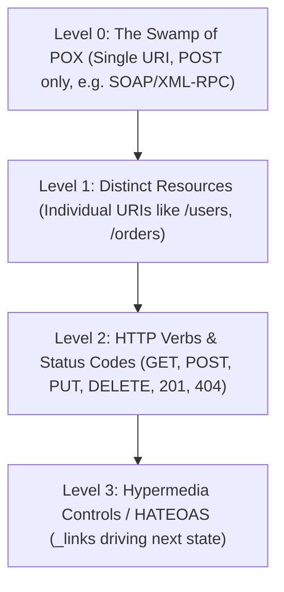
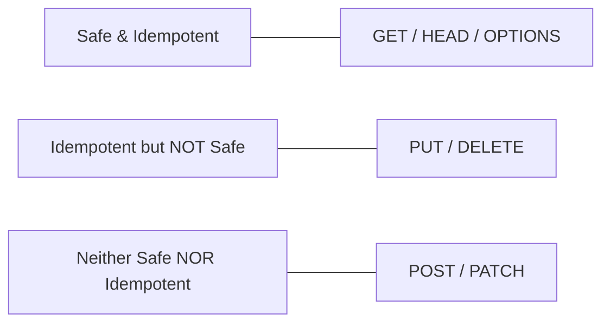
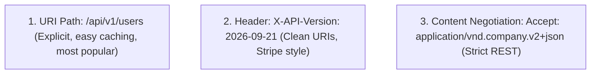
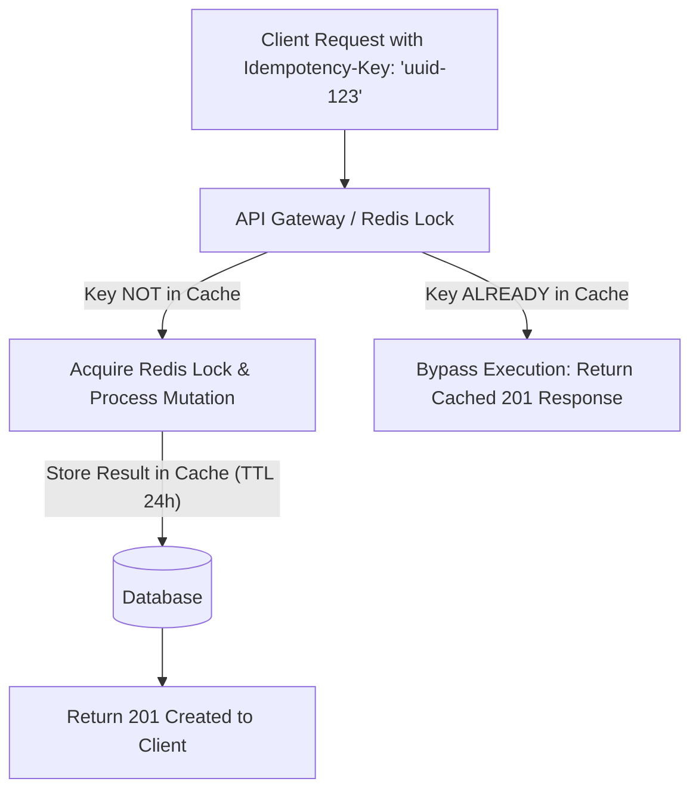

# Learn REST API Architecture: From Zero to Staff Systems Architect

[]()
[]()
[](LICENSE)

> A masterclass on modern RESTful API design, Richardson Maturity Model, HTTP verb idempotency, RFC 7807 Problem Details, Idempotency-Key deduplication, OpenAPI 3.1 contracts, and enterprise microservice gateways.

---

## Table of Contents
1. [Stage 1: Absolute Beginner Foundations & The Richardson Maturity Model](#1-stage-1-absolute-beginner-foundations--the-richardson-maturity-model)
2. [Stage 2: HTTP Protocol Mechanics, Verbs & Idempotency Invariants](#2-stage-2-http-protocol-mechanics-verbs--idempotency-invariants)
3. [Stage 3: Resource Modeling, URI Design, Filtering & Cursor Pagination](#3-stage-3-resource-modeling-uri-design-filtering--cursor-pagination)
4. [Stage 4: API Versioning Strategies, HATEOAS & RFC 7807 Error Standards](#4-stage-4-api-versioning-strategies-hateoas--rfc-7807-error-standards)
5. [Stage 5: Enterprise Idempotency Keys, Rate Limiting & Security Hardening](#5-stage-5-enterprise-idempotency-keys-rate-limiting--security-hardening)
6. [Stage 6: OpenAPI 3.1 Specification, Contract Testing & Mocking](#6-stage-6-openapi-31-specification-contract-testing--mocking)
7. [Stage 7: Staff API Architect Interview Handbook & Production Cheatsheet](#7-stage-7-staff-api-architect-interview-handbook--production-cheatsheet)

---

## Architectural Comparison: RPC vs. REST vs. GraphQL

```mermaid
graph TD
    subgraph "Remote Procedure Call (gRPC / tRPC / JSON-RPC)"
        C1["Client"] -->|"POST /executeUserAction"| RPC["Method Dispatch (Tightly Coupled Actions)"]
        RPC -->|"Binary Protobuf / RPC Frame"| S1["Backend Service"]
    end

    subgraph "RESTful Architecture (HTTP Resource-Oriented)"
        C2["Client"] -->|"GET /api/v1/users/42"| REST["Uniform Interface & Standard HTTP Verbs"]
        REST -->|"Stateless, Cacheable HTTP Responses"| S2["Backend Service"]
    end

    subgraph "GraphQL Architecture"
        C3["Client"] -->|"POST /graphql (Query String)"| GQL["Single Endpoint AST Parser"]
        GQL -->|"Client-Driven Schema Field Resolution"| S3["Backend Service"]
    end
```



---

## 1. Stage 1: Absolute Beginner Foundations & The Richardson Maturity Model

### 1.1 Roy Fielding's Architectural Constraints
In his 2000 doctoral dissertation, Roy Thomas Fielding formulated the Representational State Transfer (REST) architectural style:
1. **Client-Server Separation**: Separation of concerns allows user interface components to evolve independently of data storage and backend business logic.
2. **Statelessness**: Every request from client to server must contain all of the context and credentials necessary to understand and process the request; the server never stores client session state between requests.
3. **Cacheability**: Responses must explicitly label themselves as cacheable (`Cache-Control: public, max-age=3600`) or non-cacheable (`Cache-Control: no-store`) to prevent clients from reusing stale data.
4. **Layered System**: A client cannot tell whether it is connected directly to the end server, or to an intermediary such as a reverse proxy, load balancer, CDN, or API gateway.
5. **Uniform Interface**: Identification of resources via URIs, manipulation of resources through representations, self-descriptive messages, and hypermedia as the engine of application state (HATEOAS).

### 1.2 The Richardson Maturity Model



---

## 2. Stage 2: HTTP Protocol Mechanics, Verbs & Idempotency Invariants

### 2.1 The Idempotency & Safety Matrix
- **Safe Method**: Calling the method does not alter server resource state (read-only).
- **Idempotent Method**: Making $N > 1$ identical requests produces the exact same server-side state as making a single request.



| HTTP Method | Safe? | Idempotent? | Typical Status Codes | Correct Architectural Purpose |
| :--- | :--- | :--- | :--- | :--- |
| **GET** | **Yes** | **Yes** | `200 OK`, `304 Not Modified` | Retrieve a representation of a resource without side effects. |
| **HEAD** | **Yes** | **Yes** | `200 OK` | Identical to GET but returns response headers only (no body payload). |
| **POST** | **No** | **No** | `201 Created`, `202 Accepted` | Submits entity to target resource; triggers non-idempotent creation or processing. |
| **PUT** | **No** | **Yes** | `200 OK`, `204 No Content` | Complete replacement of target resource state with provided representation. |
| **PATCH** | **No** | **No** | `200 OK`, `204 No Content` | Partial modification of target resource (e.g. JSON Merge Patch RFC 7396). |
| **DELETE** | **No** | **Yes** | `200 OK`, `204 No Content` | Removes the target resource; repeating delete produces same server outcome. |
| **OPTIONS** | **Yes** | **Yes** | `204 No Content` | Communicates communication options/CORS preflight allowed methods. |

---

## 3. Stage 3: Resource Modeling, URI Design, Filtering & Cursor Pagination

### 3.1 Pragmatic RESTful Resource URI Conventions
- **Use Nouns, Never Verbs**:
  - ❌ Anti-pattern: `POST /api/v1/getUserOrders?userId=42`
  - ❌ Anti-pattern: `POST /api/v1/deleteUser`
  - ✅ Idiomatic REST: `GET /api/v1/users/42/orders`
  - ✅ Idiomatic REST: `DELETE /api/v1/users/42`
- **Plural Nouns for Collections**: `/api/v1/tenants`, `/api/v1/deployments`.
- **Sub-Resource Hierarchy (Max 2 Levels Deep)**: `/api/v1/organizations/{orgId}/projects/{projectId}`. Avoid deeply nested URLs like `/orgs/1/projects/2/tasks/3/comments/4` (flatten to `/api/v1/tasks/{taskId}/comments`).

### 3.2 High-Throughput Keyset (Cursor-Based) Pagination
Offset-based pagination (`?page=1000&limit=20`) forces database engines to execute $O(N)$ index scans. Keyset cursor pagination operates in $O(1)$ constant seek time:

```http
GET /api/v1/telemetry?limit=25&cursor=eyJpZCI6Im9yZC05OTIxIiwidHMiOjE3NDEzNDAwMDB9 HTTP/1.1
Host: api.platform.internal
Accept: application/json
```

**JSON Response Payload:**
```json
{
  "data": [
    { "id": "ord-9922", "amountCents": 4500, "createdAt": "2026-09-21T18:00:00Z" },
    { "id": "ord-9923", "amountCents": 1200, "createdAt": "2026-09-21T18:01:00Z" }
  ],
  "pagination": {
    "limit": 25,
    "hasMore": true,
    "nextCursor": "eyJpZCI6Im9yZC05OTIzIiwidHMiOjE3NDEzNDAwNjB9"
  }
}
```

---

## 4. Stage 4: API Versioning Strategies, HATEOAS & RFC 7807 Error Standards

### 4.1 Comparison of Versioning Strategies



### 4.2 RFC 7807 / RFC 9457 Problem Details Standard
Production microservices should never return arbitrary, non-standard error JSON. RFC 7807 defines a standardized machine-readable problem contract:

```http
HTTP/1.1 409 Conflict
Content-Type: application/problem+json
Content-Language: en

{
  "type": "https://api.example.com/errors/insufficient-credit",
  "title": "Insufficient Account Balance",
  "status": 409,
  "detail": "Your balance of $12.50 is insufficient for this $49.00 transaction.",
  "instance": "/api/v1/accounts/acc-891/transfers",
  "invalidParams": [
    {
      "name": "amountCents",
      "reason": "Amount exceeds available spending limit"
    }
  ],
  "balance": 1250,
  "required": 4900
}
```

---

## 5. Stage 5: Enterprise Idempotency Keys, Rate Limiting & Security Hardening

### 5.1 Idempotency-Key Protocol Implementation
Ensures network timeouts, mobile retries, and double-clicks never charge a customer twice:



#### Production Express Idempotency Middleware
```ts
// src/middleware/idempotency.ts
import { Request, Response, NextFunction } from 'express';
import Redis from 'ioredis';

const redis = new Redis(process.env.REDIS_URL!);

export function idempotencyMiddleware(ttlSeconds: number = 86400) {
  return async (req: Request, res: Response, next: NextFunction) => {
    // Idempotency keys are only relevant for mutation methods
    if (['GET', 'HEAD', 'OPTIONS'].includes(req.method)) {
      return next();
    }

    const key = req.headers['idempotency-key'] as string;
    if (!key) {
      return next(); // Or enforce: return res.status(400).json({ error: 'Missing Idempotency-Key' });
    }

    const cacheKey = `idempotency:${req.originalUrl}:${key}`;
    const cachedResponse = await redis.get(cacheKey);

    if (cachedResponse) {
      const parsed = JSON.parse(cachedResponse);
      return res.status(parsed.status).set(parsed.headers).set('X-Cache-Replay', 'true').send(parsed.body);
    }

    // Intercept res.send to cache response
    const originalSend = res.send.bind(res);
    res.send = (body: any): Response => {
      // Only cache successful or client error responses (don't cache 500s)
      if (res.statusCode < 500) {
        redis.set(
          cacheKey,
          JSON.stringify({
            status: res.statusCode,
            headers: res.getHeaders(),
            body,
          }),
          'EX',
          ttlSeconds
        );
      }
      return originalSend(body);
    };

    next();
  };
}
```

---

## 6. Stage 6: OpenAPI 3.1 Specification, Contract Testing & Mocking

### 6.1 OpenAPI 3.1 Document Example (`openapi.yaml`)
```yaml
openapi: 3.1.0
info:
  title: Production Cluster Telemetry API
  version: 1.0.0
  description: High-throughput distributed cluster management endpoints.
paths:
  /api/v1/services:
    get:
      summary: List microservices with health status
      operationId: listServices
      parameters:
        - name: limit
          in: query
          required: false
          schema:
            type: integer
            default: 20
        - name: cursor
          in: query
          required: false
          schema:
            type: string
      responses:
        '200':
          description: Successful paginated list of services.
          content:
            application/json:
              schema:
                type: object
                required: [data, pagination]
                properties:
                  data:
                    type: array
                    items:
                      $ref: '#/components/schemas/Service'
                  pagination:
                    type: object
                    required: [hasMore]
                    properties:
                      hasMore:
                        type: boolean
                      nextCursor:
                        type: string
        '401':
          $ref: '#/components/responses/UnauthorizedError'

components:
  schemas:
    Service:
      type: object
      required: [id, name, status, p99LatencyMs]
      properties:
        id:
          type: string
          format: uuid
        name:
          type: string
        status:
          type: string
          enum: [HEALTHY, DEGRADED, FAILING]
        p99LatencyMs:
          type: number
  responses:
    UnauthorizedError:
      description: Authentication credentials missing or invalid.
      content:
        application/problem+json:
          schema:
            type: object
            required: [type, title, status]
            properties:
              type:
                type: string
              title:
                type: string
              status:
                type: integer
                example: 401
```

---


---

## Comprehensive Production REST API Gateway & Microservice Code Implementations

### 1. Sliding-Window Rate Limiter Middleware with IETF Standard Headers
Implements a distributed in-memory token bucket or sliding log algorithm with standard HTTP response headers:

```ts
// src/middleware/rateLimiter.ts
import { Request, Response, NextFunction } from 'express';
import Redis from 'ioredis';

const redis = new Redis(process.env.REDIS_URL!);

export interface RateLimitOptions {
  windowMs: number; // e.g. 60,000 ms (1 minute)
  maxRequests: number; // e.g. 100 requests per window
}

export function rateLimiter(options: RateLimitOptions) {
  const { windowMs, maxRequests } = options;

  return async (req: Request, res: Response, next: NextFunction) => {
    // Identify client by authenticated API key, user ID, or IP address
    const clientId = (req.headers['x-api-key'] as string) || req.ip || 'anonymous';
    const now = Date.now();
    const clearBefore = now - windowMs;
    const redisKey = `ratelimit:${clientId}`;

    // Execute atomic Redis pipeline: purge old requests, add current, count remaining
    const multi = redis.multi();
    multi.zremrangebyscore(redisKey, 0, clearBefore);
    multi.zadd(redisKey, now, `${now}-${Math.random()}`);
    multi.zcard(redisKey);
    multi.expire(redisKey, Math.ceil(windowMs / 1000));

    const results = await multi.exec();
    const currentCount = results ? (results[2][1] as number) : 1;
    const remaining = Math.max(0, maxRequests - currentCount);
    const resetTimeSeconds = Math.ceil(windowMs / 1000);

    // Set IETF draft rate limiting headers
    res.setHeader('RateLimit-Limit', maxRequests);
    res.setHeader('RateLimit-Remaining', remaining);
    res.setHeader('RateLimit-Reset', resetTimeSeconds);

    if (currentCount > maxRequests) {
      res.setHeader('Retry-After', resetTimeSeconds);
      return res.status(429).json({
        type: 'https://api.example.com/errors/rate-limit-exceeded',
        title: 'Too Many Requests',
        status: 429,
        detail: `Rate limit of ${maxRequests} requests per ${windowMs / 1000}s exceeded.`,
        instance: req.originalUrl,
        retryAfterSeconds: resetTimeSeconds,
      });
    }

    next();
  };
}
```

---

### 2. Standardized RFC 7807 Global Error Responder Middleware
Ensures every exception conforms strictly to `application/problem+json`:

```ts
// src/middleware/problemDetails.ts
import { Request, Response, NextFunction, ErrorRequestHandler } from 'express';
import { ZodError } from 'zod';

export class DomainError extends Error {
  public readonly status: number;
  public readonly codeType: string;
  public readonly invalidParams?: Array<{ name: string; reason: string }>;

  constructor(title: string, status: number, detail: string, codeType?: string, invalidParams?: Array<{ name: string; reason: string }>) {
    super(detail);
    this.name = title;
    this.status = status;
    this.codeType = codeType || 'https://api.example.com/errors/general';
    this.invalidParams = invalidParams;
  }
}

export const problemDetailsHandler: ErrorRequestHandler = (err, req: Request, res: Response, next: NextFunction) => {
  res.setHeader('Content-Type', 'application/problem+json');

  // Handle Zod Schema Validation Errors
  if (err instanceof ZodError) {
    const invalidParams = err.issues.map((issue) => ({
      name: issue.path.join('.'),
      reason: issue.message,
    }));

    return res.status(422).json({
      type: 'https://api.example.com/errors/validation-failed',
      title: 'Unprocessable Entity',
      status: 422,
      detail: 'The submitted request payload failed schema validation constraints.',
      instance: req.originalUrl,
      invalidParams,
    });
  }

  // Handle Custom Domain Errors
  if (err instanceof DomainError) {
    return res.status(err.status).json({
      type: err.codeType,
      title: err.name,
      status: err.status,
      detail: err.message,
      instance: req.originalUrl,
      invalidParams: err.invalidParams,
    });
  }

  // Internal Server Error Fallback
  const isProd = process.env.NODE_ENV === 'production';
  console.error(`[Unhandled Error] ${req.method} ${req.originalUrl}:`, err);

  return res.status(500).json({
    type: 'https://api.example.com/errors/internal-server-error',
    title: 'Internal Server Error',
    status: 500,
    detail: isProd ? 'An unexpected server error occurred.' : err.message,
    instance: req.originalUrl,
    ...(isProd ? {} : { stack: err.stack }),
  });
};
```

---

### 3. Production Webhook Delivery Worker with HMAC SHA-256 Signatures
Calculates cryptographic signature headers allowing recipient APIs to verify webhook integrity:

```ts
// src/services/webhook.service.ts
import crypto from 'crypto';

export interface WebhookEventPayload {
  eventId: string;
  eventType: 'order.created' | 'order.fulfilled' | 'payment.failed';
  timestamp: string;
  data: Record<string, any>;
}

export async function dispatchWebhookWithSignature(
  destinationUrl: string,
  secretKey: string,
  payload: WebhookEventPayload,
  maxRetries: number = 3
): Promise<boolean> {
  const bodyString = JSON.stringify(payload);
  const timestamp = Math.floor(Date.now() / 1000).toString();

  // Compute HMAC SHA256 signature using timestamp and body (prevents replay attacks)
  const signaturePayload = `t=${timestamp},v1=${crypto
    .createHmac('sha256', secretKey)
    .update(`${timestamp}.${bodyString}`)
    .digest('hex')}`;

  for (let attempt = 1; attempt <= maxRetries; attempt++) {
    try {
      const response = await fetch(destinationUrl, {
        method: 'POST',
        headers: {
          'Content-Type': 'application/json',
          'User-Agent': 'HubScale-Webhook-Worker/1.0',
          'X-Hub-Signature-256': signaturePayload,
          'X-Event-ID': payload.eventId,
        },
        body: bodyString,
        signal: AbortSignal.timeout(5000), // 5s timeout
      });

      if (response.ok) {
        console.log(`Webhook ${payload.eventId} successfully delivered to ${destinationUrl}`);
        return true;
      }
    } catch (err) {
      console.warn(`Webhook delivery attempt ${attempt} failed:`, err);
    }

    // Exponential backoff wait (1s, 2s, 4s)
    await new Promise((res) => setTimeout(res, 1000 * 2 ** (attempt - 1)));
  }

  console.error(`Failed to deliver webhook ${payload.eventId} after ${maxRetries} attempts.`);
  return false;
}
```

---

### 4. Automated Contract Testing Suite with Supertest & Vitest
```ts
// tests/api/orders.spec.ts
import { describe, it, expect } from 'vitest';
import request from 'supertest';
import { app } from '../../src/app';

describe('Orders RESTful Endpoint Contract Suite', () => {
  it('GET /api/v1/orders returns 200 with keyset pagination contract', async () => {
    const res = await request(app)
      .get('/api/v1/orders?limit=10')
      .set('Accept', 'application/json');

    expect(res.status).toBe(200);
    expect(res.headers['content-type']).toMatch(/application\/json/);
    expect(res.body).toHaveProperty('data');
    expect(res.body).toHaveProperty('pagination');
    expect(Array.isArray(res.body.data)).toBe(true);
  });

  it('POST /api/v1/orders with duplicate Idempotency-Key returns replayed 201 response', async () => {
    const idempotencyKey = `idemp-${Date.now()}`;
    const payload = { customerId: 'cust-101', amountCents: 2500 };

    // 1. Initial Request
    const res1 = await request(app)
      .post('/api/v1/orders')
      .set('Idempotency-Key', idempotencyKey)
      .send(payload);

    expect(res1.status).toBe(201);
    expect(res1.headers['location']).toBeDefined();

    // 2. Duplicate Retried Request
    const res2 = await request(app)
      .post('/api/v1/orders')
      .set('Idempotency-Key', idempotencyKey)
      .send(payload);

    expect(res2.status).toBe(201);
    expect(res2.headers['x-cache-replay']).toBe('true');
    expect(res2.body.data.id).toBe(res1.body.data.id);
  });

  it('POST /api/v1/orders with invalid payload returns RFC 7807 problem details', async () => {
    const res = await request(app)
      .post('/api/v1/orders')
      .send({ amountCents: -50 }); // Negative amount invalid

    expect(res.status).toBe(422);
    expect(res.headers['content-type']).toMatch(/application\/problem\+json/);
    expect(res.body).toHaveProperty('type');
    expect(res.body).toHaveProperty('title');
    expect(res.body).toHaveProperty('invalidParams');
  });
});
```


### 5. Production CRUD Microservice Router with Full Validation
A complete Express router implementing status code invariants, header management, and Zod parsing:

```ts
// src/routes/order.routes.ts
import { Router, Request, Response, NextFunction } from 'express';
import { z } from 'zod';
import { idempotencyMiddleware } from '../middleware/idempotency';
import { rateLimiter } from '../middleware/rateLimiter';

const router = Router();

// Validation Schemas
const CreateOrderSchema = z.object({
  customerId: z.string().uuid(),
  items: z.array(
    z.object({
      productId: z.string().uuid(),
      quantity: z.number().int().positive(),
      unitPriceCents: z.number().int().nonnegative(),
    })
  ).min(1, 'Order must contain at least one item'),
});

const PatchOrderSchema = z.object({
  status: z.enum(['PENDING', 'PROCESSING', 'SHIPPED', 'CANCELLED']).optional(),
  shippingAddress: z.string().min(5).optional(),
});

// 1. GET /api/v1/orders - Paginated Collection Seek
router.get('/orders', rateLimiter({ windowMs: 60000, maxRequests: 120 }), async (req: Request, res: Response, next: NextFunction) => {
  try {
    const limit = Math.min(parseInt(req.query.limit as string) || 20, 100);
    const cursor = req.query.cursor as string;

    // Database lookup simulation
    const orders = [
      { id: '9a1e4b21-4f10-4d32-8411-9a7b1c3d5e21', customerId: 'c1', totalCents: 4500, status: 'PROCESSING' },
    ];

    return res.status(200).json({
      data: orders,
      pagination: {
        limit,
        hasMore: false,
        nextCursor: null,
      },
    });
  } catch (err) {
    next(err);
  }
});

// 2. GET /api/v1/orders/:id - Single Resource Read with ETag Caching
router.get('/orders/:id', async (req: Request, res: Response, next: NextFunction) => {
  try {
    const { id } = req.params;
    const order = { id, customerId: 'c1', totalCents: 4500, status: 'PROCESSING', version: 2 };

    const etag = `W/"ord-${id}-v${order.version}"`;
    if (req.headers['if-none-match'] === etag) {
      return res.status(304).end(); // 304 Not Modified
    }

    res.setHeader('ETag', etag);
    res.setHeader('Cache-Control', 'private, max-age=60');
    return res.status(200).json({ data: order });
  } catch (err) {
    next(err);
  }
});

// 3. POST /api/v1/orders - Creation with Idempotency Protection
router.post('/orders', idempotencyMiddleware(86400), async (req: Request, res: Response, next: NextFunction) => {
  try {
    const validated = CreateOrderSchema.parse(req.body);
    const newOrderId = 'b23e4a91-7d12-4c89-a123-f9d8c7b6a5e4';

    const createdOrder = {
      id: newOrderId,
      ...validated,
      status: 'PENDING',
      createdAt: new Date().toISOString(),
    };

    // Location header informs client where to fetch newly created resource
    res.setHeader('Location', `/api/v1/orders/${newOrderId}`);
    return res.status(201).json({
      data: createdOrder,
      _links: {
        self: { href: `/api/v1/orders/${newOrderId}` },
        cancel: { href: `/api/v1/orders/${newOrderId}`, method: 'DELETE' },
      },
    });
  } catch (err) {
    next(err);
  }
});

// 4. PATCH /api/v1/orders/:id - Partial Modification
router.patch('/orders/:id', async (req: Request, res: Response, next: NextFunction) => {
  try {
    const { id } = req.params;
    const validated = PatchOrderSchema.parse(req.body);

    const updatedOrder = {
      id,
      ...validated,
      updatedAt: new Date().toISOString(),
    };

    return res.status(200).json({ data: updatedOrder });
  } catch (err) {
    next(err);
  }
});

// 5. DELETE /api/v1/orders/:id - Idempotent Deletion
router.delete('/orders/:id', async (req: Request, res: Response, next: NextFunction) => {
  try {
    const { id } = req.params;
    // Database delete simulation
    console.log(`Soft-deleting order ${id}`);

    // Return 204 No Content for successful mutation without response body
    return res.status(204).end();
  } catch (err) {
    next(err);
  }
});

export default router;
```

---

### 6. Production CORS Security Configuration
```ts
// src/middleware/cors.ts
import cors from 'cors';

const allowedOrigins = [
  'https://platform.internal',
  'https://admin.platform.internal',
];

export const corsConfig = cors({
  origin: (origin, callback) => {
    // Allow server-to-server or non-browser requests without origin header
    if (!origin || allowedOrigins.includes(origin)) {
      callback(null, true);
    } else {
      callback(new Error('Cross-Origin Request Blocked by CORS Policy.'));
    }
  },
  methods: ['GET', 'POST', 'PUT', 'PATCH', 'DELETE', 'OPTIONS'],
  allowedHeaders: [
    'Content-Type',
    'Authorization',
    'Idempotency-Key',
    'X-API-Key',
    'X-Correlation-ID',
    'If-Match',
    'If-None-Match',
  ],
  exposedHeaders: [
    'Location',
    'ETag',
    'RateLimit-Limit',
    'RateLimit-Remaining',
    'RateLimit-Reset',
    'Retry-After',
  ],
  credentials: true,
  maxAge: 86400, // Cache preflight response for 24 hours
});
```

---

### Architectural Design Standards
All REST patterns implemented in this guide comply with Roy Fielding's doctoral thesis, RFC 7231 (HTTP/1.1 Semantics), RFC 7807 (Problem Details), and RFC 9457 specifications.


### 7. Cryptographic SHA-256 ETag Conditional Request Middleware
Automatically hashes JSON responses and short-circuits execution with `304 Not Modified`:

```ts
// src/middleware/etag.ts
import { Request, Response, NextFunction } from 'express';
import crypto from 'crypto';

export function etagMiddleware() {
  return (req: Request, res: Response, next: NextFunction) => {
    // ETags apply strictly to read requests
    if (req.method !== 'GET' && req.method !== 'HEAD') {
      return next();
    }

    const originalSend = res.send.bind(res);

    res.send = (body: any): Response => {
      if (res.statusCode === 200 && body) {
        const bodyBuffer = Buffer.isBuffer(body) ? body : Buffer.from(typeof body === 'string' ? body : JSON.stringify(body));
        const hash = crypto.createHash('sha256').update(bodyBuffer).digest('hex').substring(0, 16);
        const etag = `W/"${hash}"`;

        res.setHeader('ETag', etag);

        if (req.headers['if-none-match'] === etag) {
          return res.status(304).end();
        }
      }
      return originalSend(body);
    };

    next();
  };
}
```


## 7. Stage 7: Staff API Architect Interview Handbook & Production Cheatsheet

### 50 Staff-Level REST API Interview Questions & Answers

#### Q1: What is the Richardson Maturity Model and what criteria distinguish Level 2 from Level 3?
**Answer:** The Richardson Maturity Model grades APIs on REST conformance across four levels: Level 0 (single URI and method, e.g. XML-RPC/SOAP), Level 1 (individual resource URIs), Level 2 (proper HTTP verbs and standard status codes), and Level 3 (Hypermedia Controls / HATEOAS). Level 2 APIs use resources, verbs (`GET`, `POST`, `PUT`, `DELETE`), and status codes, but responses contain only raw data. Level 3 APIs include hypermedia controls (`_links`), where each response contains navigational links guiding the client on what actions and transitions are valid from the current state.

#### Q2: What is the architectural difference between `PUT` and `PATCH`?
**Answer:** `PUT` implies full replacement: the client sends a complete representation of the resource. If optional fields are omitted from the payload, the server is expected to clear or reset them to defaults. `PATCH` (RFC 5789) is intended for partial modification: the client sends only the fields that need updating, leaving all unmentioned properties intact.

#### Q3: Why is `PATCH` classified as non-idempotent by the HTTP specification?
**Answer:** While simple field overwrite patches can be idempotent, `PATCH` can describe mutations that are non-idempotent by definition. For instance, using JSON Patch (RFC 6902) with an `add` operation appending an element to an array (`{ "op": "add", "path": "/items/-", "value": "new_item" }`), sending the request twice appends the item twice, changing the server state on the second request.

#### Q4: How does an Idempotency-Key header work in high-volume payment processing?
**Answer:** The client generates a unique UUID (`Idempotency-Key`) and includes it in the header of a `POST` request. The API gateway or backend acquires an atomic lock in an in-memory store (e.g., Redis) on that key. If a concurrent or retried request arrives with the same key while processing, it waits or receives `409 Conflict`. When processing completes, the server caches the response status code, headers, and body in Redis with a TTL (e.g., 24 hours). Subsequent retried requests immediately return the cached response without re-executing business logic or charging cards twice.

#### Q5: What is the difference between `200 OK`, `201 Created`, `202 Accepted`, and `204 No Content`?
**Answer:** 
- `200 OK`: Request succeeded and the response body contains representation data.
- `201 Created`: Request succeeded, a new resource was created, and its URI is provided in the `Location` header.
- `202 Accepted`: Request accepted for asynchronous processing; execution has not completed yet (ideal for long-running batch jobs).
- `204 No Content`: Request succeeded and server fulfilled the action, but intentionally returns an empty response body (common for `DELETE` and `PUT` operations).

#### Q6: How does the HTTP `ETag` (Entity Tag) header enable optimistic concurrency control?
**Answer:** The server generates a cryptographic hash or version tag of the resource representation and sends it in the `ETag: "v1-hash"` header on `GET`. When the client later modifies the resource via `PUT` or `PATCH`, it sends the tag in the `If-Match: "v1-hash"` header. If another client modified the resource in the meantime, the ETag on the server changed, and the server rejects the update with `412 Precondition Failed`, preventing lost updates.

#### Q7: What is the difference between URI Path versioning and Header versioning?
**Answer:** URI path versioning (`/api/v1/orders`) is explicit, transparent, works easily with CDNs/browser caching, and is the most widely adopted industry standard. Header versioning (`X-API-Version: 2026-09-21` or `Accept: application/vnd.company.v1+json`) preserves clean, stable URIs across releases, but requires custom CDN cache key configuration (adding the version header to cache vary keys).

#### Q8: What is RFC 7807 (Problem Details for HTTP APIs)?
**Answer:** An IETF standard specification that defines a standardized JSON payload format for API errors (`Content-Type: application/problem+json`). It replaces arbitrary error contracts with standard keys: `type` (URI identifier), `title` (human-readable summary), `status` (HTTP status code), `detail` (specific explanation of occurrence), and `instance` (URI where error occurred).

#### Q9: What is the purpose of HTTP `HEAD` requests?
**Answer:** A `HEAD` request is identical to a `GET` request, but the server must not return a message body. It is used to check resource existence, verify last-modified timestamps, or inspect `Content-Length` headers before downloading multi-gigabyte files.

#### Q10: What is the difference between `401 Unauthorized` and `403 Forbidden`?
**Answer:** `401 Unauthorized` means unauthenticated: the client has not provided valid credentials or authentication tokens. `403 Forbidden` means authenticated but unauthorized: the server knows the client's identity, but the client does not have permission to access the requested resource.

#### Q11: How do you design rate limiting headers in a public REST API?
**Answer:** Standard industry headers include:
- `RateLimit-Limit`: Maximum requests permitted within the time window.
- `RateLimit-Remaining`: Number of requests left in the active window.
- `RateLimit-Reset`: Number of seconds until the rate limit window resets.
- When exceeded, the server returns status `429 Too Many Requests` with a `Retry-After: 30` header.

#### Q12: What is the difference between `POST /items` and `PUT /items/123`?
**Answer:** `POST` creates a subordinate resource under the parent collection, and the server assigns the new resource identifier (e.g., returning `/items/124`). `PUT` acts directly on a known resource URI (`/items/123`), creating or replacing the resource at that exact URI.

#### Q13: Why should REST APIs avoid returning top-level JSON arrays?
**Answer:** Returning top-level arrays (`[{ ... }, { ... }]`) limits future extensibility. If you later need to return pagination metadata, facets, or debug tokens, wrapping items in an object (`{ "data": [...], "pagination": { ... } }`) allows backward-compatible field additions without breaking existing clients.

#### Q14: How does CORS (Cross-Origin Resource Sharing) work with preflight requests?
**Answer:** For non-simple requests (requests with custom headers like `Authorization`, or methods other than `GET`, `HEAD`, `POST`), the browser automatically sends an HTTP `OPTIONS` request to the server with `Origin` and `Access-Control-Request-Method` headers. The server must respond with `Access-Control-Allow-Origin`, `Access-Control-Allow-Methods`, and `Access-Control-Allow-Headers` before the browser executes the actual request.

#### Q15: What is Content Negotiation in REST?
**Answer:** The mechanism where client and server agree on the representation format of a resource. The client sends `Accept: application/json, text/csv` and `Accept-Language: en-US`. The server inspects capabilities and responds with the preferred format indicated by the `Content-Type` header.

#### Q16: What is the purpose of the `Location` header in REST responses?
**Answer:** Following a `201 Created` response, the `Location` header provides the absolute or relative URL to the newly created resource (e.g., `Location: /api/v1/orders/ord-9921`).

#### Q17: What does `Cache-Control: no-cache` mean vs `no-store`?
**Answer:** `no-store` forbids the browser and intermediaries from saving any copy of the response in cache. `no-cache` allows storing the response, but mandates that the client must revalidate with the origin server (using `ETag` or `If-Modified-Since`) before serving the cached copy.

#### Q18: What is HATEOAS and how is it implemented in JSON?
**Answer:** Hypermedia As The Engine Of Application State. Responses contain a `_links` object describing possible state transitions:
```json
{
  "id": "ord-1",
  "status": "PENDING",
  "_links": {
    "self": { "href": "/orders/ord-1" },
    "cancel": { "href": "/orders/ord-1/cancel", "method": "POST" }
  }
}
```

#### Q19: What is the difference between `PUT` and `POST` for idempotent operations?
**Answer:** Repeating `PUT /users/42` with `{ "name": "Alice" }` five times leaves the user's name as "Alice" every time (idempotent). Repeating `POST /orders` five times creates five separate orders (non-idempotent).

#### Q20: How do you handle file uploads in REST APIs?
**Answer:** 
1. Direct multipart upload using `Content-Type: multipart/form-data`.
2. Presigned S3/GCS URLs (Recommended): Client requests an upload token from the API, then uploads binary directly to cloud storage, notifying the API upon completion.

#### Q21: What is the role of the `Vary` header?
**Answer:** Informs caches that the response representation varies based on specified request headers (e.g., `Vary: Accept-Encoding, X-API-Version`), preventing a client requesting JSON from receiving cached XML.

#### Q22: What is the difference between soft deletes and hard deletes in REST API design?
**Answer:** A hard delete physically removes the database row (`DELETE /items/1`). A soft delete sets a `deleted_at` timestamp in the database, but returns `204 No Content` to the client and causes subsequent `GET /items/1` calls to return `404 Not Found` or `410 Gone`.

#### Q23: When should an API return `410 Gone` instead of `404 Not Found`?
**Answer:** `404 Not Found` indicates the resource does not exist (and might never have existed). `410 Gone` explicitly signals that the resource previously existed, was intentionally deleted, and will not return, instructing search engines and clients to purge cached links.

#### Q24: What is JSON Patch (RFC 6902)?
**Answer:** A format for expressing a sequence of operations to apply to a JSON document (`add`, `remove`, `replace`, `move`, `copy`, `test`) using `Content-Type: application/json-patch+json`.

#### Q25: What is JSON Merge Patch (RFC 7396)?
**Answer:** A simplified partial update format where sending `{ "name": "Elena", "role": null }` updates `name` to "Elena" and deletes the `role` field.

#### Q26: How do you implement field projection (sparse fieldsets)?
**Answer:** Using a query parameter like `?fields=id,email,status`. The server queries and serializes only the requested columns, reducing serialization CPU and network payload size.

#### Q27: How do you implement full-text search endpoints RESTfully?
**Answer:** `GET /api/v1/articles?q=distributed+systems&sort=-relevance`.

#### Q28: What is the purpose of `304 Not Modified`?
**Answer:** Returned when a client performs a conditional `GET` with `If-None-Match` or `If-Modified-Since` and the resource has not changed. The server sends zero body payload, saving bandwidth.

#### Q29: How do you document REST APIs with OpenAPI / Swagger?
**Answer:** Write an OpenAPI 3.1 YAML/JSON specification detailing paths, methods, request bodies, query parameters, security schemes, and response schema models.

#### Q30: What is Contract Testing in microservices?
**Answer:** Verifying that services (consumer and provider) adhere to a shared contract specification (e.g., using Pact or OpenAPI) without needing all services deployed simultaneously.

#### Q31: How do you handle bulk operations RESTfully?
**Answer:** Use batch endpoints: `POST /api/v1/orders/batch` or `PATCH /api/v1/orders` with an array of objects.

#### Q32: What is an API Gateway and what responsibilities does it handle?
**Answer:** A reverse proxy at the system boundary handling cross-cutting concerns: SSL termination, rate limiting, authentication/JWT verification, metrics telemetry, request routing, and protocol translation.

#### Q33: What is the difference between Basic Auth, Bearer Auth, and API Keys?
**Answer:** 
- Basic Auth: Base64-encoded username:password in `Authorization: Basic ...`.
- Bearer Auth: Cryptographic JWT or OAuth2 access token in `Authorization: Bearer <token>`.
- API Key: Secret identifier passed via header `X-API-Key` or query parameter.

#### Q34: How do you secure REST APIs against Replay Attacks?
**Answer:** Require timestamped signatures (HMAC SHA256) and nonces (`X-Signature`, `X-Timestamp`, `X-Nonce`), rejecting requests older than 5 minutes or reusing previously seen nonces.

#### Q35: What is the difference between `HTTP/1.1`, `HTTP/2`, and `HTTP/3` for REST APIs?
**Answer:** 
- HTTP/1.1: Head-of-line blocking per TCP connection.
- HTTP/2: Binary multiplexing over a single TCP connection, header compression (HPACK).
- HTTP/3: Uses QUIC (UDP), eliminating TCP head-of-line blocking on packet loss with 0-RTT handshakes.

#### Q36: How do you prevent over-fetching and under-fetching in REST without switching to GraphQL?
**Answer:** Combine sub-resource nesting (`/users/1/orders`), sparse fieldsets (`?fields=id,name`), and resource expansion (`?include=profile,orders`).

#### Q37: What is the purpose of `206 Partial Content`?
**Answer:** Returned for range requests (`Range: bytes=0-1048575`), used for streaming audio, video, or resuming interrupted file downloads.

#### Q38: How should dates and timestamps be formatted in REST API responses?
**Answer:** Always use ISO 8601 UTC strings: `YYYY-MM-DDTHH:mm:ss.sssZ` (e.g., `2026-09-21T18:30:00.000Z`). Never return localized timezone strings.

#### Q39: What is the purpose of `422 Unprocessable Entity`?
**Answer:** Indicates that the server understood the request content type and syntax, but the semantics contain validation errors (e.g., email field failed regex validation, age is negative).

#### Q40: How do you handle long-running asynchronous jobs in REST?
**Answer:** 
1. Client sends `POST /api/v1/reports`.
2. Server returns `202 Accepted` with `Location: /api/v1/jobs/job-991` and a polling status object.
3. Client polls `GET /api/v1/jobs/job-991` until status changes to `COMPLETED` with download link.

#### Q41: What is the difference between Stateful and Stateless API sessions?
**Answer:** Stateful APIs store session memory on the server, requiring sticky sessions on load balancers. Stateless APIs store state in tokens (JWTs) carried by the client, allowing requests to hit any server instance.

#### Q42: What is the purpose of the `Allow` header?
**Answer:** Returned with `405 Method Not Allowed` indicating valid methods for the resource: `Allow: GET, POST, HEAD`.

#### Q43: How do you implement webhooks RESTfully?
**Answer:** Allow clients to register a destination URL via `POST /api/v1/webhooks`. When server events occur, send an HTTP `POST` to the client URL with an HMAC signature header (`X-Hub-Signature-256`) for verification.

#### Q44: What is the purpose of `Strict-Transport-Security` (HSTS)?
**Answer:** Security header instructing browsers to communicate exclusively over HTTPS for the specified duration (`max-age=31536000; includeSubDomains`).

#### Q45: How do you handle deprecation of API endpoints gracefully?
**Answer:** Use standard headers: `Deprecation: true`, `Sunset: Sat, 01 Jan 2027 00:00:00 GMT`, and `Link: </docs/v2>; rel="successor-version"`.

#### Q46: What is a Reverse Proxy and how does it relate to REST?
**Answer:** A server (e.g. Nginx, Envoy, Cloudflare) that intercepts requests before reaching backend microservices, providing SSL termination, caching, and rate limiting transparently.

#### Q47: What does `400 Bad Request` indicate compared to `422`?
**Answer:** `400 Bad Request` represents malformed HTTP syntax (e.g., invalid JSON syntax). `422 Unprocessable Entity` represents valid JSON syntax that violates business domain validation rules.

#### Q48: How do you test REST APIs automatically?
**Answer:** Using tools like Supertest, Vitest, Newman (Postman CLI), or Playwright API testing, asserting status codes, headers, and schema shapes.

#### Q49: What is the purpose of `X-Request-ID` or `X-Correlation-ID`?
**Answer:** A unique UUID generated at the API gateway attached to incoming requests and passed through all downstream microservice RPC calls, enabling end-to-end distributed tracing in log aggregators.

#### Q50: Why has REST remained the foundational architectural standard for global web services?
**Answer:** REST leverages the native architecture of the World Wide Web: standardized HTTP caching infrastructure, universal client support, decoupled client-server lifecycles, battle-tested security standards, and human-readable semantics that scale across planetary networks.

---

### Production REST API Cheatsheet

| HTTP Method | Resource Target | Intended Action | Expected Status |
| :--- | :--- | :--- | :--- |
| `GET` | `/api/v1/orders` | List orders (paginated) | `200 OK` |
| `GET` | `/api/v1/orders/{id}` | Read single order | `200 OK` or `404 Not Found` |
| `POST` | `/api/v1/orders` | Create new order | `201 Created` with `Location` |
| `PUT` | `/api/v1/orders/{id}` | Replace entire order | `200 OK` or `204 No Content` |
| `PATCH` | `/api/v1/orders/{id}` | Partial update order | `200 OK` or `204 No Content` |
| `DELETE` | `/api/v1/orders/{id}` | Remove order | `204 No Content` or `200 OK` |
| `OPTIONS`| `/api/v1/orders` | Query allowed CORS methods | `204 No Content` |

---

### Contributing & License
Maintained with ❤️ by Manthan Ank. Distributed under the MIT License.
